# Cardiopatía isquémica: guía para estudiantes de medicina y clínicos

> Material educativo. No sustituye el juicio clínico ni las guías institucionales vigentes.

**Contenido**

1. [Epidemiología en México](#1-epidemiología-en-méxico)
2. [Infarto de miocardio: Quinta Definición Universal (2026)](#2-infarto-de-miocardio-quinta-definición-universal-2026)
3. [Síndromes coronarios agudos (SCA o SICA): Guías ESC 2023](#3-síndromes-coronarios-agudos-sca-o-sica-guías-esc-2023)
4. [SCA sin elevación del ST (SCA-SEST / IMSEST)](#4-sca-sin-elevación-del-st-sca-sest--imsest)
5. [SCA según la Guía ACC/AHA 2025](#5-sca-según-la-guía-accaha-2025)
6. [IAM con elevación del ST (IAMCEST): protocolo ICAT3](#6-iam-con-elevación-del-st-iamcest-protocolo-icat3)
7. [Cardiopatía isquémica crónica y miocardiopatía isquémica](#7-cardiopatía-isquémica-crónica-y-miocardiopatía-isquémica)
8. [Resumen: iCARDIO Alliance 2026](#8-resumen-icardio-alliance-2026)
9. [Choque cardiogénico](#9-choque-cardiogénico)
10. [Referencias](#10-referencias)

---

## 1. Epidemiología en México

**INEGI.** Las enfermedades del corazón son la **principal causa de muerte en México, tanto en hombres como en mujeres**. En el primer trimestre de 2026 se registraron 49,252 defunciones por enfermedades del corazón de un total de 207,599 (22,848 en mujeres y 26,397 en hombres), por encima de la diabetes mellitus y los tumores malignos.

**OCDE, *Health at a Glance 2025* (nota de país, México).**

| Indicador | México | Promedio OCDE |
|---|---|---|
| Mortalidad prevenible (por 100 000) | 243 | 145 |
| Mortalidad tratable (por 100 000) | 175 | 77 |
| Personas que fuman diariamente | 8.5 % | 14.8 % |
| Adultos con actividad física insuficiente | 28 % | 30 % |
| Mortalidad a 30 días tras IAM (datos no vinculados) | **22.6 %** | 6.5 % |
| Mortalidad a 30 días tras evento vascular cerebral | 17.0 % | 7.7 % |

México ocupa el segundo lugar en obesidad y el primero en obesidad y sobrepeso.

> La mortalidad a 30 días tras un IAM en México es más de tres veces el promedio de la OCDE: el problema no es solo la frecuencia de la enfermedad, sino el **tiempo y el acceso a la reperfusión** (ver sección 5).

**Consenso Mexicano sobre la Cardiopatía Isquémica Crónica (COMECITE, 2021).**

- La cardiopatía isquémica tiene una prevalencia de alrededor de **30 % en adultos mayores de 40 años** en México y es la principal causa de muerte.
- El enfoque diagnóstico, la estratificación y la selección de pacientes para cateterismo varían entre la atención institucional y la privada y según los recursos tecnológicos disponibles, independientemente de las guías ACC/AHA.
- Es indispensable reconocer las diferencias entre los **síndromes coronarios agudos y crónicos**.

---

## 2. Infarto de miocardio: Quinta Definición Universal (2026)

La Quinta Definición Universal del Infarto de Miocardio (ESC/ACC/AHA/WHF, 2026) actualiza la clasificación para alinearla con la fisiopatología, la evaluación clínica y criterios diagnósticos objetivos, y por primera vez se alinea con la codificación CIE-11.

### 2.1 Definición

- **Anatomopatológica:** muerte de células miocárdicas debida a periodos prolongados de isquemia (flujo coronario insuficiente o ausente) y a la lesión por reperfusión. El diagnóstico histopatológico requiere autopsia.
- **Clínica:** se basa en las manifestaciones clínicas, los biomarcadores, el electrocardiograma y las técnicas de imagen coronaria o cardíaca. Exige **pruebas indirectas de muerte celular irreversible** y la confirmación de que esa muerte fue **causada por isquemia miocárdica**.
- **Ningún criterio aislado** confirma el diagnóstico: se requieren varios criterios que, en conjunto, aumenten la probabilidad de infarto.

### 2.2 Lesión miocárdica ≠ infarto

- **Lesión miocárdica:** troponina cardíaca por encima del **percentil 99 del límite superior de referencia (LSR), específico por sexo**.
  - **Aguda:** ascenso y/o descenso de la troponina en mediciones seriadas.
  - **Crónica:** troponina persistentemente elevada por una enfermedad cardíaca subyacente o una condición no cardíaca asociada a remodelado.
- **Infarto agudo de miocardio:** lesión miocárdica aguda **más** evidencia de isquemia (≥1):
  - síntomas de isquemia;
  - cambios isquémicos en el ECG;
  - pérdida nueva de miocardio viable en imagen;
  - trombo coronario.

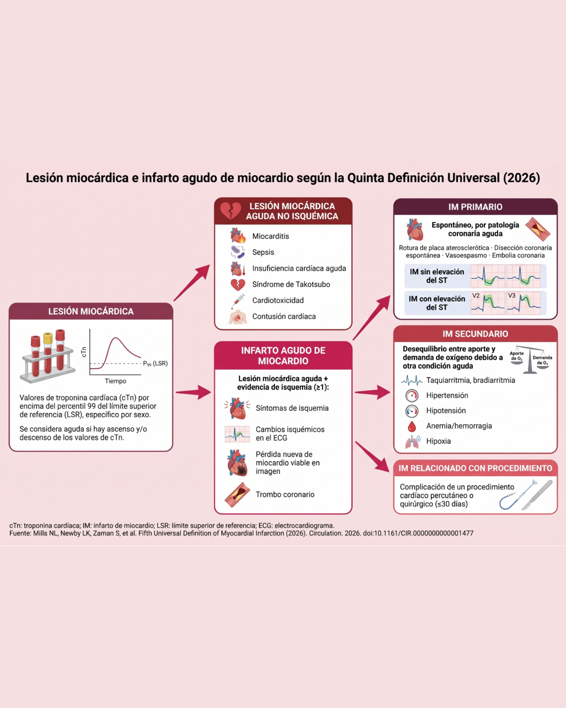

### 2.3 Tres contextos clínicos del IM (reemplazan los tipos 1 a 5)

| Quinta Definición (2026) | Antes (Cuarta, 2018) | Descripción |
|---|---|---|
| **IM primario** | Tipo 1 | Espontáneo, por patología coronaria aguda. La mayoría por aterotrombosis; otras causas (disección coronaria espontánea, vasoespasmo, embolia coronaria) se identifican con imagen coronaria y pruebas funcionales. |
| **IM secundario** | Tipo 2 | Consecuencia de otro cuadro agudo que provoca desequilibrio entre aporte y demanda de oxígeno. Se proponen criterios objetivos para orientar el uso de imagen cardíaca y coronaria. |
| **IM relacionado con procedimiento** | Tipos 4 y 5 | Complicación de un procedimiento cardíaco percutáneo o quirúrgico (≤30 días). |

**MINOCA** pasa a significar *lesión* miocárdica (no infarto) con arterias coronarias no obstructivas: es un **diagnóstico de trabajo**, no final.

### 2.4 Mecanismos de lesión miocárdica

**Aguda (Tabla 2):**

| Mecanismo | Condiciones |
|---|---|
| Isquemia | Infarto de miocardio |
| Inflamación | Miocarditis (autoinmune, infecciosa, tóxica); rechazo de trasplante cardíaco; mediada por citocinas en sepsis |
| Estrés hemodinámico | Desequilibrio aporte–demanda*; taquiarritmia o bradiarritmia; insuficiencia cardíaca aguda; tromboembolia pulmonar aguda; hipertensión maligna |
| Estrés fisiológico | Ejercicio extenuante |
| Estrés catecolaminérgico | Síndrome de Takotsubo; hemorragia subaracnoidea; evento vascular cerebral; crisis epilépticas; feocromocitoma |
| Toxicidad | Antraciclinas; terapias dirigidas contra ErbB; inhibidores de tirosina cinasa; inhibidores de puntos de control inmunitario; inducida por radiación |
| Traumatismo | Cardioversión eléctrica; intervención coronaria o estructural percutánea; ablación con catéter o implante de dispositivos; cirugía cardíaca; contusión cardíaca |

\*Cualquier condición aguda con desequilibrio de oxígeno miocárdico por menor aporte (hipoxia, anemia, hipotensión) y/o mayor demanda (taquicardia, hipertensión).

**Crónica (Tabla 3):**

| Mecanismo | Condiciones |
|---|---|
| Isquemia | Síndrome coronario crónico; miocardiopatía isquémica |
| Otras miocardiopatías | Hipertrófica; hipertensiva; dilatada; inflamatoria crónica; restrictiva; infiltrativa; urémica en enfermedad renal crónica |
| Estrés hemodinámico | Insuficiencia cardíaca crónica; hipertensión sistémica; hipertensión pulmonar |
| Estructural | Valvulopatía; cardiopatía congénita; tumor cardíaco |

| Lesión aguda | Lesión crónica |
|---|---|
| 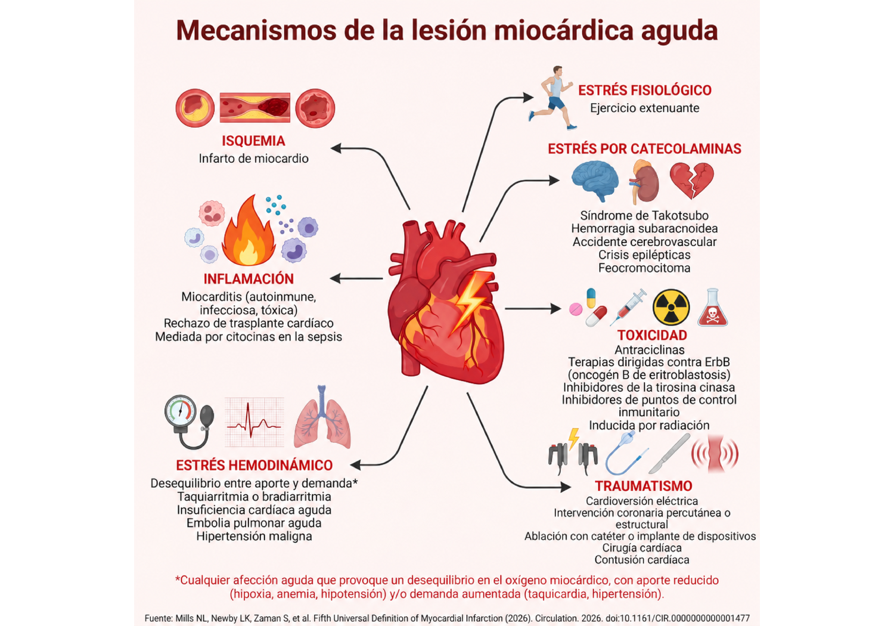 | 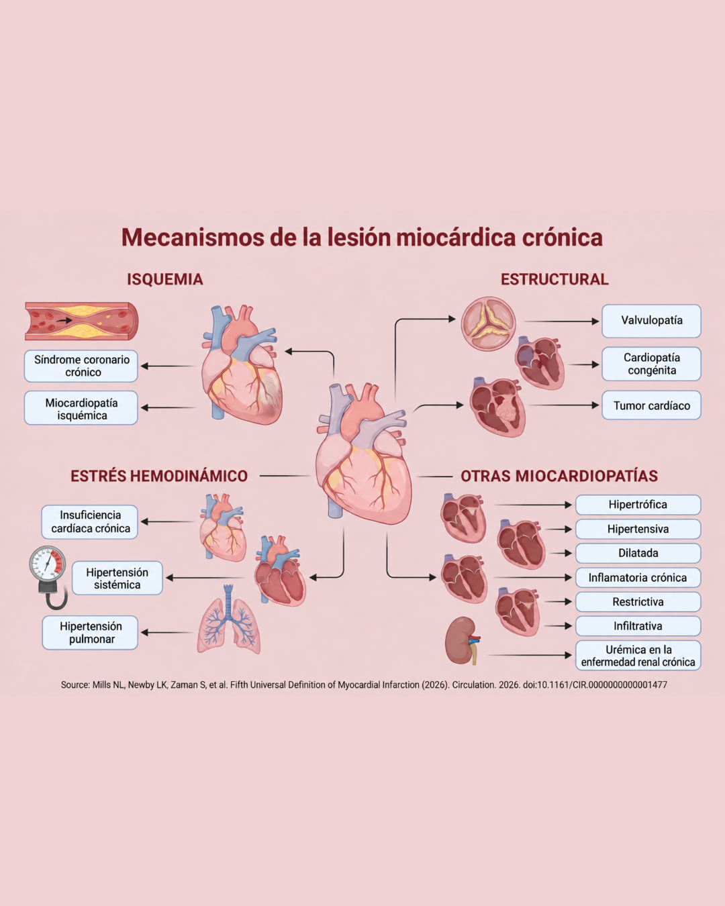 |

---

## 3. Síndromes coronarios agudos (SCA o SICA): Guías ESC 2023

Los **síndromes coronarios agudos (SCA)** abarcan un espectro de afecciones que incluyen a pacientes con cambios recientes en sus síntomas o signos clínicos, con o sin alteraciones en el ECG de 12 derivaciones, y con o sin elevaciones agudas de la troponina cardíaca (cTn). Los pacientes con sospecha de SCA pueden recibir, finalmente, un diagnóstico de **infarto agudo de miocardio (IAM)** o **angina inestable (AI)**.

### 3.1 Clasificación

```
                    SÍNDROME CORONARIO AGUDO
                               │
            ┌──────────────────┴──────────────────┐
     Angina inestable (AI)          Infarto agudo de miocardio (IAM)
     isquemia sin necrosis                         │
                                    ┌──────────────┴──────────────┐
                                 IAMCEST                       IAMSEST
                          (con elevación del ST)       (sin elevación del ST)
```

- **Angina inestable:** isquemia miocárdica en reposo o ante un esfuerzo mínimo, **sin** lesión o necrosis aguda de los cardiomiocitos. Se manifiesta como angina prolongada (>20 min) en reposo; angina grave de reciente aparición; angina que aumenta en frecuencia o duración o aparece con umbrales de esfuerzo cada vez menores; o angina tras un IM reciente.
- **Infarto agudo de miocardio:** necrosis de cardiomiocitos en un contexto clínico de isquemia miocárdica aguda. Se subdivide según el ECG en **IAMCEST** e **IAMSEST**.
- **Lesión miocárdica:** liberación de troponina por mecanismos que no cumplen los criterios de infarto. Puede ser aguda o crónica según existan cambios dinámicos en mediciones seriadas. Causas: miocarditis, sepsis, miocardiopatía de Takotsubo, valvulopatías, arritmias e insuficiencia cardíaca (IC).

### 3.2 Presentaciones clínicas

Pacientes asintomáticos · molestias o síntomas torácicos persistentes (dolor torácico y precordial) · paro cardíaco · inestabilidad eléctrica o hemodinámica · choque cardiogénico.

### 3.3 Manejo inicial

1. El paciente con sospecha de SCA se clasifica según el **ECG al momento de la presentación**.
2. La clasificación puede cambiar según la presencia o ausencia de **elevación de troponina**.
3. ECG y troponina son fundamentales para el triaje, el diagnóstico, la estratificación de riesgo y la estrategia inicial.
4. Tras la fase aguda y la estabilización, la mayor parte del tratamiento posterior es **común a todos los SCA** y puede abordarse con un protocolo común.

| | |
|---|---|
| 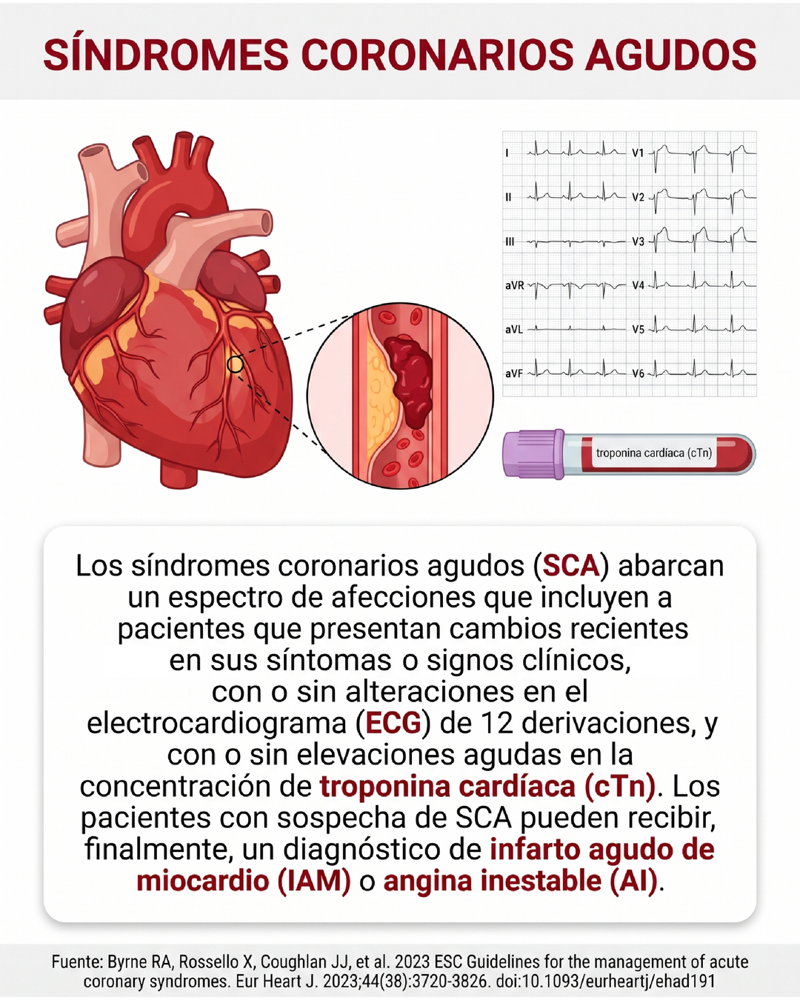 | 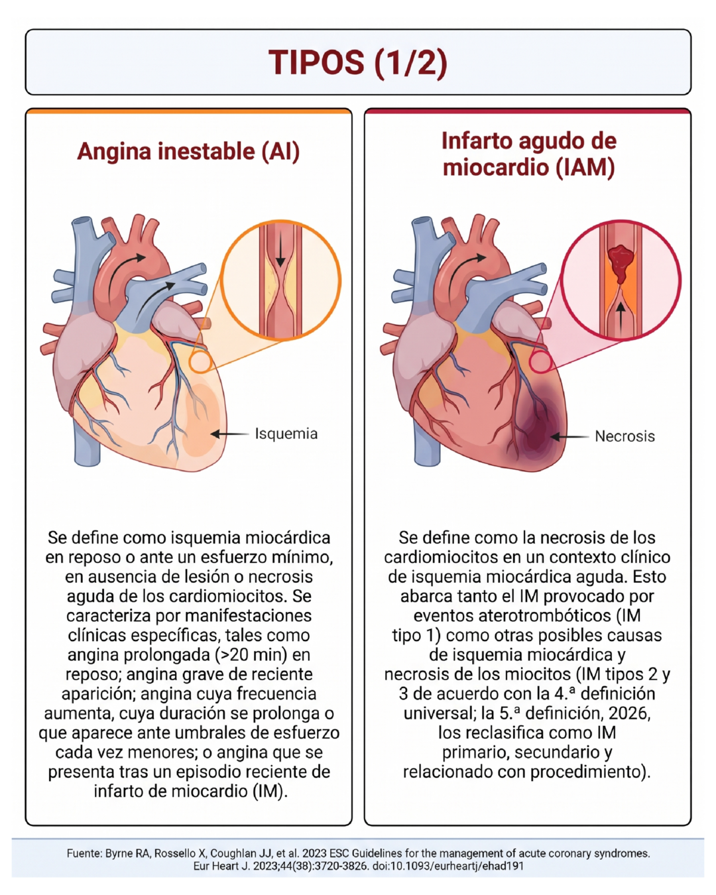 |
| 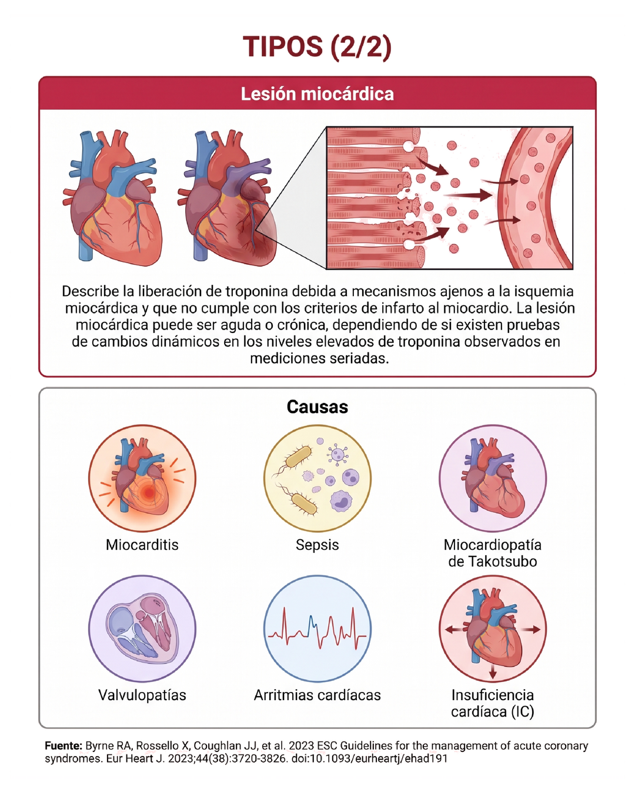 | 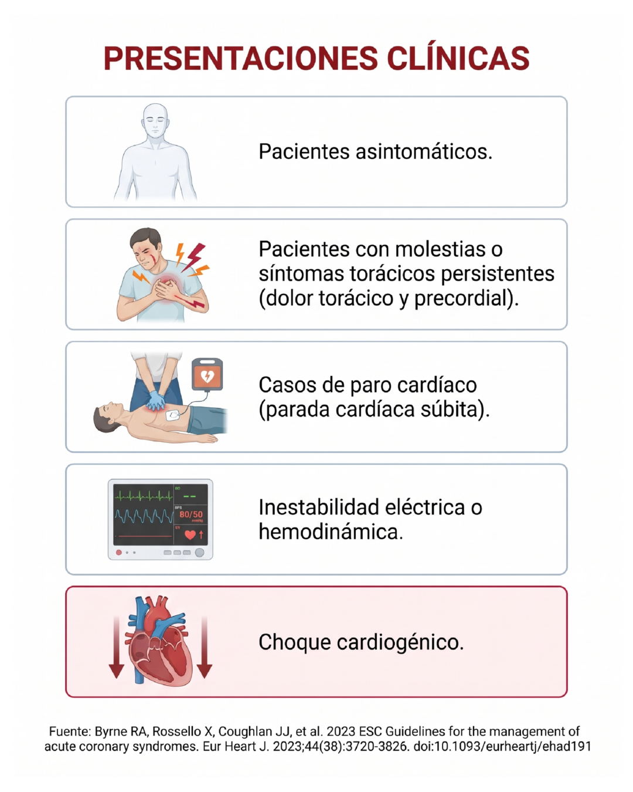 |

### 3.4 El ECG en el SCA: RENASICA III

El **Tercer Registro Nacional de Síndromes Coronarios Agudos (RENASICA III)** clasifica a los SCA según el ECG en cuatro grupos:

| Grupo | Criterio |
|---|---|
| Normal o inespecífico | Depresión del ST <0.05 mV u onda T negativa asimétrica <0.2 mV; hipertrofia ventricular; ritmo de marcapasos |
| Depresión del ST | >0.05 mV en dos derivaciones contiguas u onda T negativa simétrica >0.2 mV |
| Elevación transitoria del ST | Punto J con pendiente positiva (>0.2 mV en V1–V3 y >0.1 mV en otras derivaciones) en dos derivaciones contiguas, con normalización del ST u onda T negativa profunda residual, espontánea o por tratamiento |
| Elevación persistente del ST | Punto J con pendiente positiva (>0.2 mV en V1–V3 y >0.1 mV en otras derivaciones) en dos derivaciones contiguas |

Las guías ESC 2023 usan umbrales de elevación del ST en V2–V3 específicos por sexo y edad.

**Infarto y bloqueo de rama izquierda.** Escuela mexicana de electrocardiografía (Sodi-Pallares): onda Q en DI, aVL, V5 o V6 sugiere infarto septal; pérdida de voltaje del QRS con onda Q en V4–V6 puede corresponder a infarto anteroseptal; RS o rs con T negativa en V4–V6 podría traducir infarto transmural. Sgarbossa: elevación del ST **concordante** ≥1 mm en derivaciones con onda R o depresión del ST ≥1 mm en V1–V3; elevación **discordante** ≥5 mm en derivaciones con onda S.

**Criterios de IAMCEST (RENASICA III):** dolor o malestar torácico ≥20 min (o equivalente); ECG con elevación persistente del ST >1 mm en ≥2 derivaciones contiguas, bloqueo de rama izquierda, o R alta en V1–V2 con depresión del ST en V1–V3 y derivaciones derechas; biomarcadores elevados (preferentemente troponina) >p99; ecocardiograma con anormalidad nueva de la movilidad. Evidencia de isquemia: documentación objetiva por ecocardiografía o medicina nuclear.

| | |
|---|---|
| 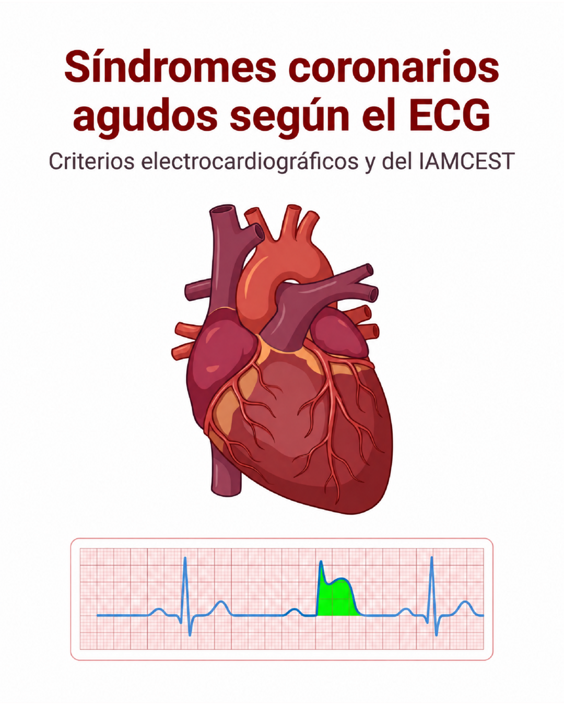 | 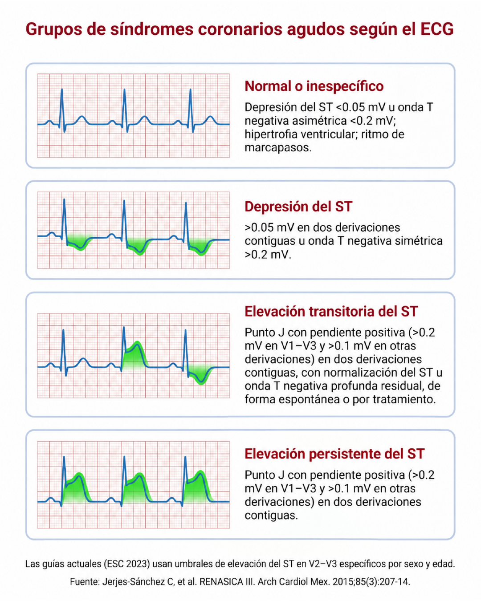 |
| 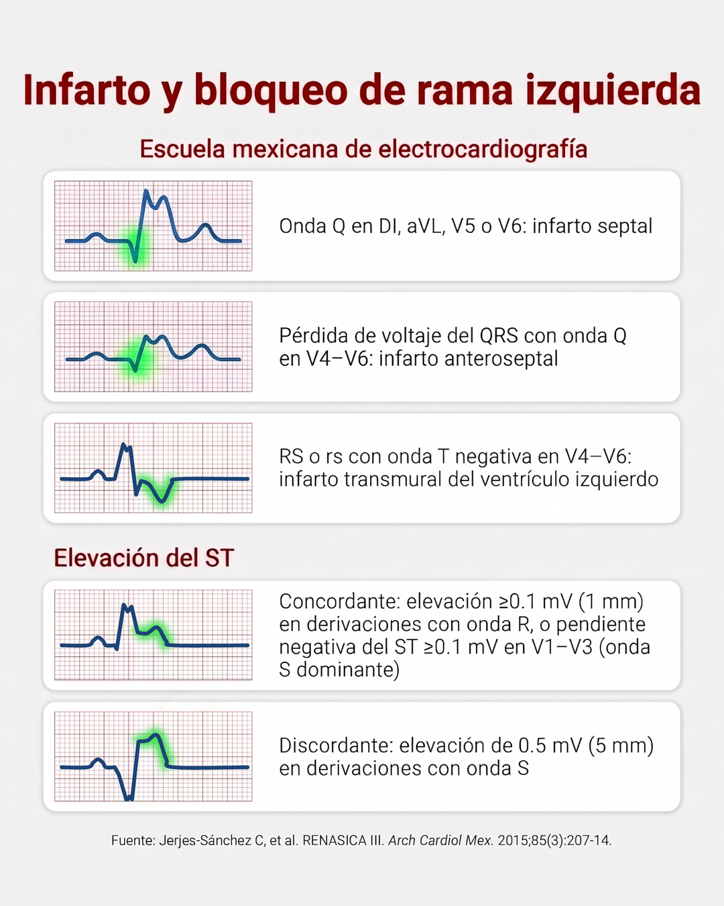 | 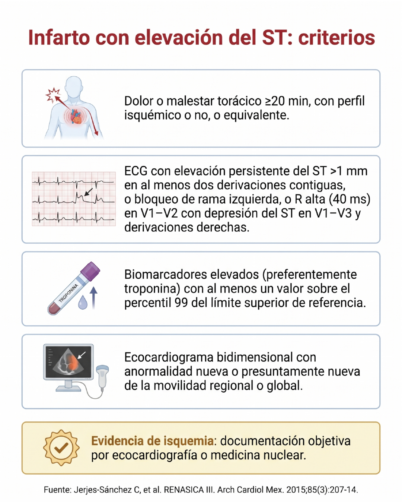 |

### 3.5 Sistemas de atención en México

- **ICAT3:** protocolo mexicano para el tratamiento del IAMCEST (Programa Nacional IAM_MX / PREMIA). Se desarrolla en la [sección 6](#6-iam-con-elevación-del-st-iamcest-protocolo-icat3).
- **Código Infarto:** protocolo institucional del IMSS para la atención del IAMCEST.

---

## 4. SCA sin elevación del ST (SCA-SEST / IMSEST)

- El **IMSEST** es más frecuente que el IAMCEST en **adultos mayores**, consecuencia de enfermedad coronaria de larga evolución con circulación colateral ya desarrollada.
- Las pruebas de **troponina de alta sensibilidad (hs-cTn)** han reducido notablemente el porcentaje de pacientes clasificados finalmente como angina inestable frente a IMSEST.

### 4.1 Evaluación clínica

- Los síntomas y signos de **insuficiencia cardíaca** y los niveles elevados de **NT-proBNP** son importantes para el diagnóstico inicial, la estratificación del riesgo y el inicio del tratamiento.
- La **creatinina** y la **hemoglobina** basales tienen implicaciones terapéuticas y pronósticas.
- La edad avanzada, los factores de riesgo, los antecedentes cardiovasculares y el tratamiento actual contribuyen al diagnóstico.

### 4.2 El ECG

- El ECG de 12 derivaciones es fundamental en cada etapa del manejo.
- Una pequeña minoría presenta **elevación transitoria del ST (<30 min)**.
- Los síntomas pueden haber remitido al primer contacto médico: realizar **ECG seriados**, sobre todo si reaparecen los síntomas, porque suelen mostrar cambios dinámicos.
- En el SCA-SEST: **~40 %** sin cambios isquémicos en el ECG; **~30 %** con depresión del ST; **~30 %** con alteraciones de la onda T, aisladas o con depresión del ST.

### 4.3 Terapia antiplaquetaria dual (DTAP)

- Las plaquetas tienen un papel central en la patogenia del SCA, lo que justifica la terapia antiplaquetaria en la fase aguda y para reducir el riesgo de IM recurrente y de trombosis del *stent*.
- **Estudio CURE:** aspirina + clopidogrel (mediana de 9 meses) redujo en **20 %** el objetivo combinado de muerte cardiovascular, IM no mortal o ictus frente a aspirina sola en SCA-SEST, con un aumento del **38 %** en el riesgo de hemorragias graves.
- **ESC 2023:** la DTAP (aspirina + inhibidor del P2Y12) se recomienda por defecto durante **12 meses** tras un SCA; prasugrel o ticagrelor se prefieren sobre clopidogrel en pacientes llevados a intervención coronaria percutánea, ajustando según el riesgo hemorrágico.

### 4.4 Estrategia invasiva (ESC 2023)

- **Inmediata (<2 h):** pacientes de muy alto riesgo (inestabilidad hemodinámica o choque cardiogénico, dolor recurrente o refractario, arritmias que ponen en riesgo la vida, complicaciones mecánicas, insuficiencia cardíaca aguda, cambios dinámicos recurrentes del ST).
- **Temprana (<24 h):** pacientes de alto riesgo (diagnóstico confirmado de IMSEST, cambios dinámicos del ST/T, elevación transitoria del ST).

| | | |
|---|---|---|
| 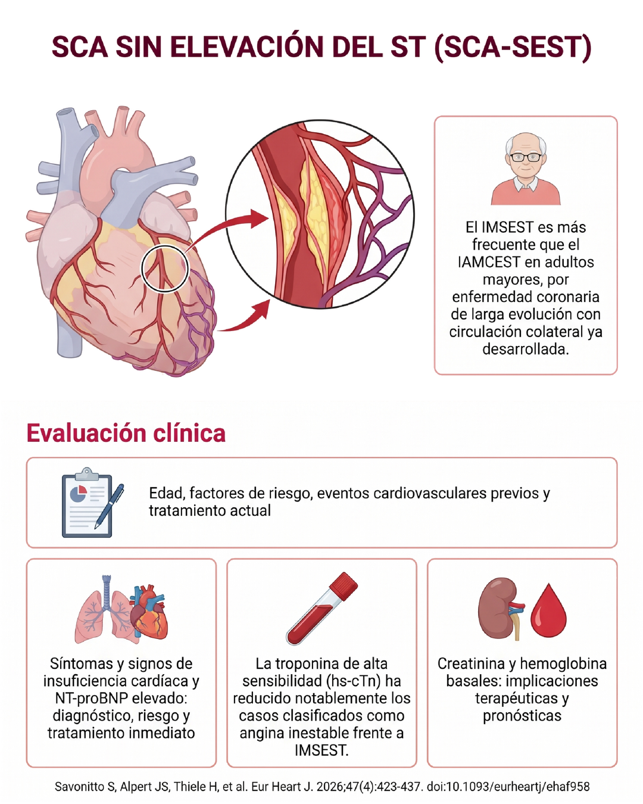 | 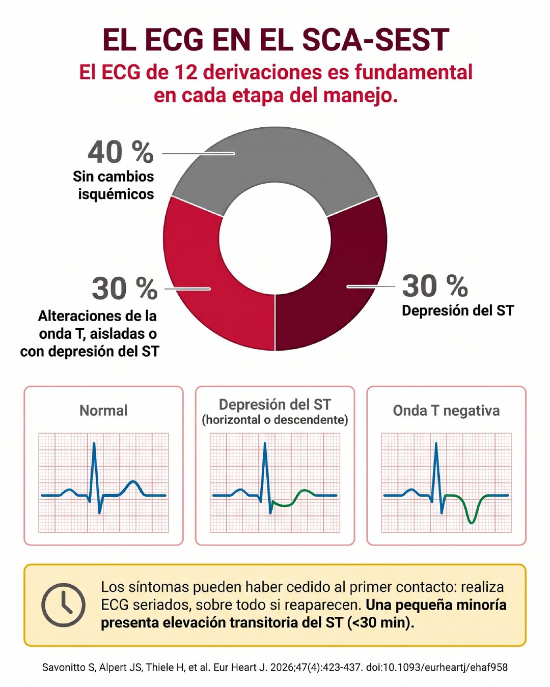 | 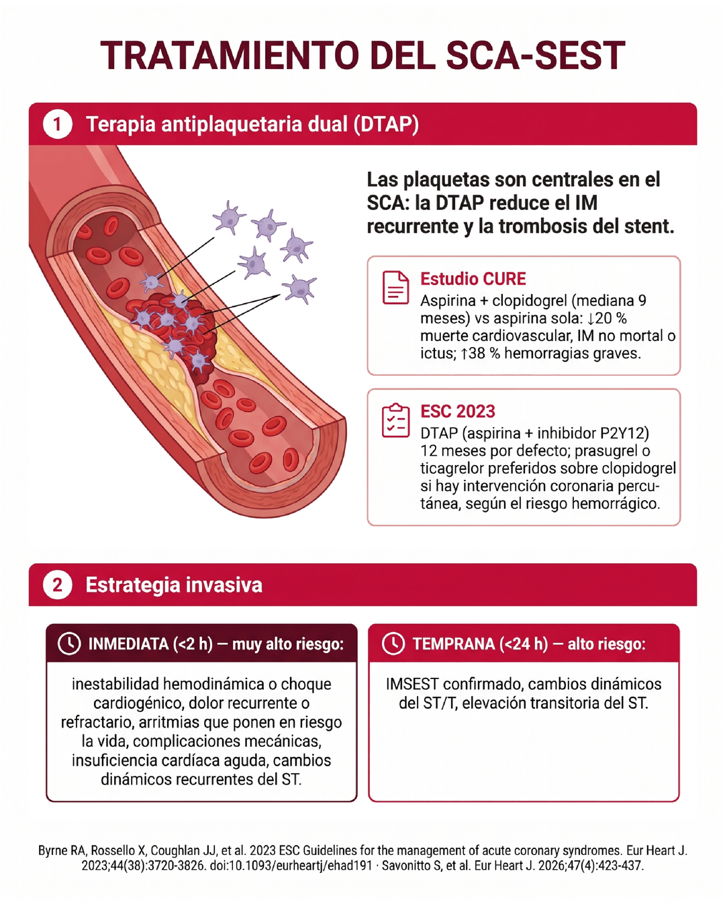 |

---

## 5. SCA según la Guía ACC/AHA 2025

> Esta sección se basa en la **Guía ACC/AHA/ACEP/NAEMSP/SCAI 2025** para el manejo de los síndromes coronarios agudos.

### 5.1 Causa, espectro y patobiología

- Los SCA son causados por la **disrupción (rotura o erosión) de una placa aterosclerótica inestable**, con trombosis parcial o completa y/o microembolias, que disminuye el flujo sanguíneo al miocardio y provoca isquemia.
- Forman un **espectro de gravedad**:
  - **Angina inestable:** isquemia transitoria sin necrosis significativa detectable por troponina.
  - **IAMSEST:** arteria parcialmente ocluida, isquemia subendocárdica y elevación de biomarcadores de mionecrosis.
  - **IAMCEST:** vaso totalmente ocluido, isquemia transmural e infarto.
- El diagnóstico inicial y la clasificación se basan en la **historia clínica y los síntomas, el ECG y la troponina cardíaca**.
- **Patobiología del IM tipo 1:** acumulación progresiva de lípidos e inflamación → placa inestable → rotura o erosión con exposición del contenido de la placa a la circulación → activación de la coagulación y trombosis → flujo comprometido → isquemia → mionecrosis.
- **Fisiopatología dinámica:** el paciente puede pasar rápidamente de angina inestable a IAMSEST o IAMCEST durante la presentación, la evaluación y el tratamiento. Otras causas menos frecuentes de isquemia: espasmo, embolia y disección coronaria.

| | |
|---|---|
| 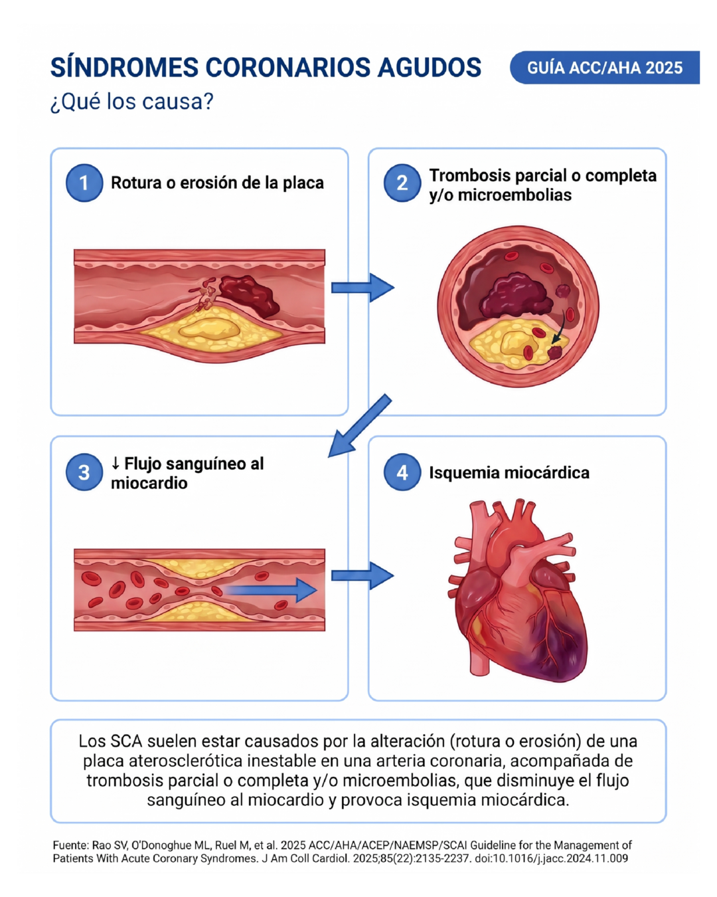 | 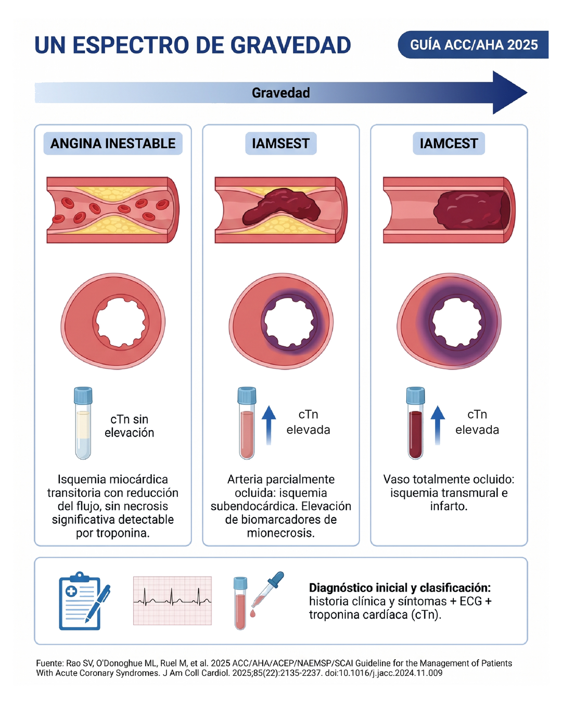 |
| 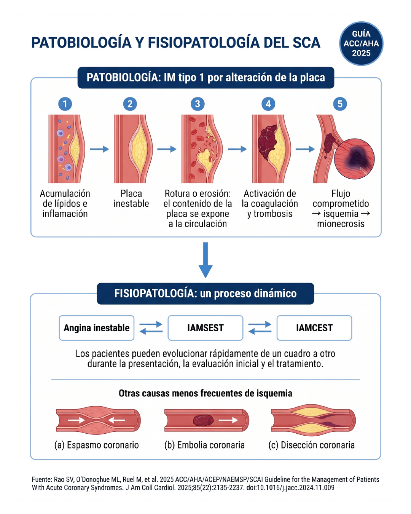 | 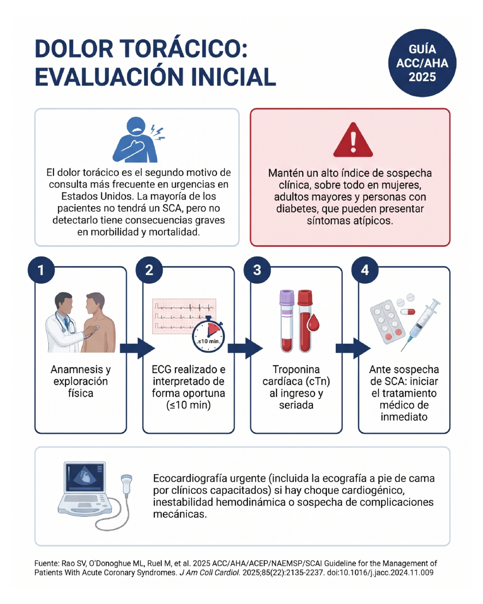 |

### 5.2 Evaluación inicial del dolor torácico

- El dolor torácico es el **segundo motivo de consulta** más frecuente en urgencias en Estados Unidos. La mayoría de los pacientes no tendrá un SCA, pero no detectarlo tiene consecuencias graves en morbilidad y mortalidad.
- Ante signos o síntomas de SCA: **anamnesis, exploración física, ECG realizado e interpretado de forma oportuna y troponina cardíaca**.
- En la sospecha de SCA, el **tratamiento médico inicial debe comenzar de inmediato**.
- **Ecocardiografía urgente** (incluida la ecografía a pie de cama por clínicos capacitados) si hay choque cardiogénico, inestabilidad hemodinámica o sospecha de complicaciones mecánicas.
- **IAMCEST:** la reperfusión rápida es lo más importante; no deben realizarse estudios que retrasen el cateterismo o la fibrinólisis, salvo que sus resultados cambien el manejo de inmediato.
- La elección de estudios adicionales depende de los antecedentes clínicos, los hallazgos del ECG, los biomarcadores, las preferencias del paciente y su capacidad para hacer ejercicio.
- Las **vías de decisión clínica** basadas en evidencia mejoran los resultados y reducen las pruebas innecesarias entre **21 % y 43 %**, manteniendo un alto **valor predictivo negativo** para eventos cardiovasculares adversos mayores (MACE).

> [!CAUTION]
> **Choque cardiogénico.** Está presente en el **7 % a 10 %** de los SCA y tiene alta mortalidad. Su reconocimiento temprano es clave para el triaje inicial y la estratificación del riesgo (ver [sección 9](#9-choque-cardiogénico)).

### 5.3 Tratamiento médico inicial

> [!NOTE]
> **Oxígeno.** Iniciar oxígeno suplementario solo si la saturación es **menor de 90 %**.

- **Ácido acetilsalicílico** en todos los pacientes, y **terapia antiplaquetaria dual** con un inhibidor del P2Y12 (clopidogrel).
- **Anticoagulación parenteral** en todos los pacientes con SCA, independientemente de la estrategia inicial, para tratar la aterotrombosis coronaria y reducir los MACE recurrentes.
- **Estatina de alta intensidad** de inmediato para reducir el riesgo de MACE.
- **Analgesia:**
  - Si los síntomas isquémicos persisten pese a nitratos, buscar una **revascularización rápida**; los opiáceos no deben usarse solo para enmascarar los síntomas.
  - Los opiáceos pueden **retrasar la absorción de los inhibidores del P2Y12 orales** (clopidogrel) y sus efectos farmacodinámicos en pacientes llevados a intervención coronaria percutánea; la relevancia clínica de este hallazgo sigue en debate.
  - **Evitar los AINE** en el dolor isquémico, incluso con sospecha sin confirmación: se asocian a mayor riesgo de MACE, con o sin enfermedad cardíaca previa, y no tienen beneficio documentado en el SCA.

---

## 6. IAM con elevación del ST (IAMCEST): protocolo ICAT3

La **reperfusión temprana** del IAMCEST es una intervención que salva vidas y la medida más importante de su tratamiento: su objetivo es restaurar el flujo de la arteria responsable del infarto y garantizar la permeabilidad del vaso.

### 6.1 ICAT3

| Letra | Paso |
|---|---|
| **I** | Identificación |
| **C** | Confirmación (ECG de 12 derivaciones en <10 min) |
| **A** | Activación |
| **T** | Tratamiento |
| **T** | Traslado |
| **T** | Retorno a su vida |

### 6.2 Algoritmo

```
DOLOR PRECORDIAL → CENTRO DE PRIMER CONTACTO → ECG <10 MIN
                                                    │
                ┌───────────────────────────────────┴──────────────┐
        SIN ELEVACIÓN DEL ST                              CON ELEVACIÓN DEL ST
                                                   ┌────────────┴────────────┐
                                           ¿Traslado <60 min?        ¿Traslado >60 min?
                                                   │                         │
                                                 ACTPp           Protocolo de fibrinólisis
                                                                 + tratamiento adjunto
                                                                             │
                                                         ¿Contraindicaciones de fibrinólisis?
                                                           SÍ → ACTPp
                                                           NO → Fibrinólisis → comunicación
                                                                + traslado → ESTRATEGIA
                                                                  FARMACOINVASIVA
```

### 6.3 El tiempo es músculo

| Tiempo desde el inicio de los síntomas | Conducta |
|---|---|
| ≤90 min | Tiempo óptimo para salvar la mayor cantidad de músculo |
| ≤3 h | Mejores resultados |
| ≤12 h | Reperfusión indicada (ACTPp o fibrinólisis) |
| 12–24 h | Fibrinólisis **contraindicada**; angioplastia con menor beneficio, decidir con cardiología |
| >24 h | La reperfusión no ofrece beneficio sobre el tratamiento conservador |

Principales retrasos en México: tiempo al diagnóstico (primer contacto → ECG interpretado), tiempo de traslado y tiempos puerta-aguja y puerta-balón.

### 6.4 Estrategias de reperfusión

- **Angioplastia primaria (ACTPp):** más efectiva (menos isquemia recurrente, reinfarto, necesidad de revascularización y sangrado cerebral; mejor flujo final). Traslado a hemodinámica en <60 min.
- **Estrategia farmacoinvasiva:** fibrinólisis seguida de angioplastia de rutina en las 3 a 24 h siguientes. Tan eficaz como la ACTPp y ampliamente disponible; en México, por la logística de traslado y la escasez de salas de hemodinámica 24/7, es una estrategia atractiva, accesible y eficaz.
- Si la ACTPp se retrasa >60 min respecto a la fibrinólisis, los resultados se equiparan. La fibrinólisis puede ser mejor si el paciente llega en <2 h y se administra en los primeros 30 min.

### 6.5 Tratamiento adjunto (dosis de carga)

| Fármaco | Dosis |
|---|---|
| Aspirina | 300 mg VO dosis única |
| Clopidogrel | 300 mg VO dosis única (75 mg si >75 años) |
| Atorvastatina | 80 mg VO dosis única |
| Enoxaparina | 30 mg IV en bolo (solo si se aplicará fibrinólisis); a los 15 min, 1 mg/kg SC cada 12 h |

Ajustes de enoxaparina según el manual: >75 años, 0.75 mg/kg SC cada 12 h (máximo 75 mg); depuración de creatinina <30 ml/min, 1 mg/kg SC cada 24 h.

**Acceso IV:** ¡cualquier acceso! Cefálica, basílica, media, dorsal: el que se obtenga más rápido.

### 6.6 Fibrinolíticos: ¡el que esté disponible!

| Fármaco | Esquema |
|---|---|
| Estreptoquinasa | 1 500 000 UI en 30–60 min |
| Alteplasa (>67 kg) | Bolo 20 mg + 80 mg en 60 min |
| Alteplasa acelerada (<67 kg) | Bolo 15 mg IV + 0.75 mg/kg (máx 50 mg) en 30 min + 0.5 mg/kg (máx 35 mg) en 60 min |
| Tenecteplasa (TNK) | Bolo en 5–10 s según peso: <60 kg 30 mg (6 ml) · 61–70 kg 35 mg (7 ml) · 71–80 kg 40 mg (8 ml) · 81–90 kg 45 mg (9 ml) · >91 kg 50 mg (10 ml) |
| Reteplasa | Disponible como alternativa |

### 6.7 Indicaciones de fibrinólisis

Dolor torácico sugestivo de isquemia >20 min, asociado a:

- elevación persistente del ST >1 mm (0.1 mV) en 2 derivaciones contiguas (excepto V2–V3: hombres >0.2 mV en >40 años y >0.25 mV en <40 años; mujeres >0.15 mV);
- o bloqueo de rama izquierda presumiblemente nuevo;
- o depresión del ST de V1 a V3 con transición precoz y elevación del ST en derivaciones posteriores (V7–V9) >0.5 mV.

Hasta 12 h del inicio de los síntomas y sin contraindicación absoluta.

### 6.8 Contraindicaciones de fibrinólisis

| Absolutas: ¡no trombolizar! | Relativas: ¿pueden tratarse? |
|---|---|
| Historia de hemorragia intracraneal | AIT en los últimos 6 meses |
| EVC isquémico en los 6 meses previos | Anticoagulantes orales |
| Neoplasia del SNC o malformación arteriovenosa | Embarazo o primera semana posparto |
| Trauma mayor, cirugía o TCE cerrado en las últimas 3 semanas | Hipertensión refractaria (PAS >180 y/o PAD >110 mmHg) |
| Hemorragia digestiva en las últimas 4 semanas | Enfermedad hepática avanzada |
| Sangrado o problema hematológico (excepto menstruación) | Endocarditis infecciosa |
| Disección aórtica (diferencia de PAS entre brazos >15 mmHg) | Úlcera péptica activa |
| Punción vascular no compresible en las últimas 24 h | Reanimación traumática o prolongada |

| | | |
|---|---|---|
| 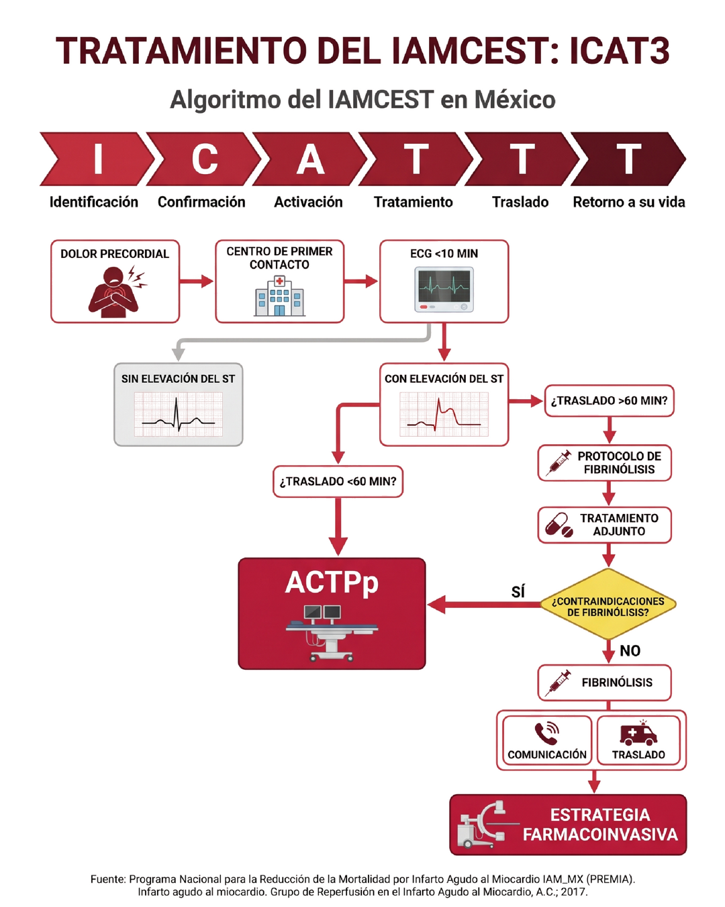 | 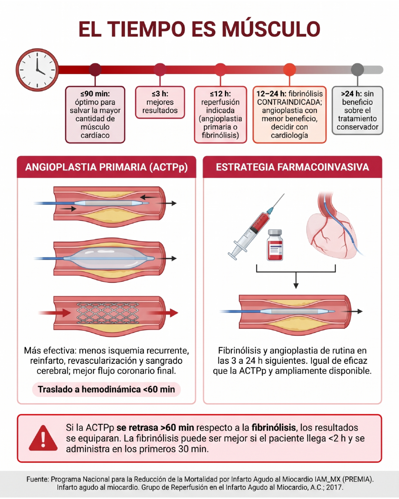 | 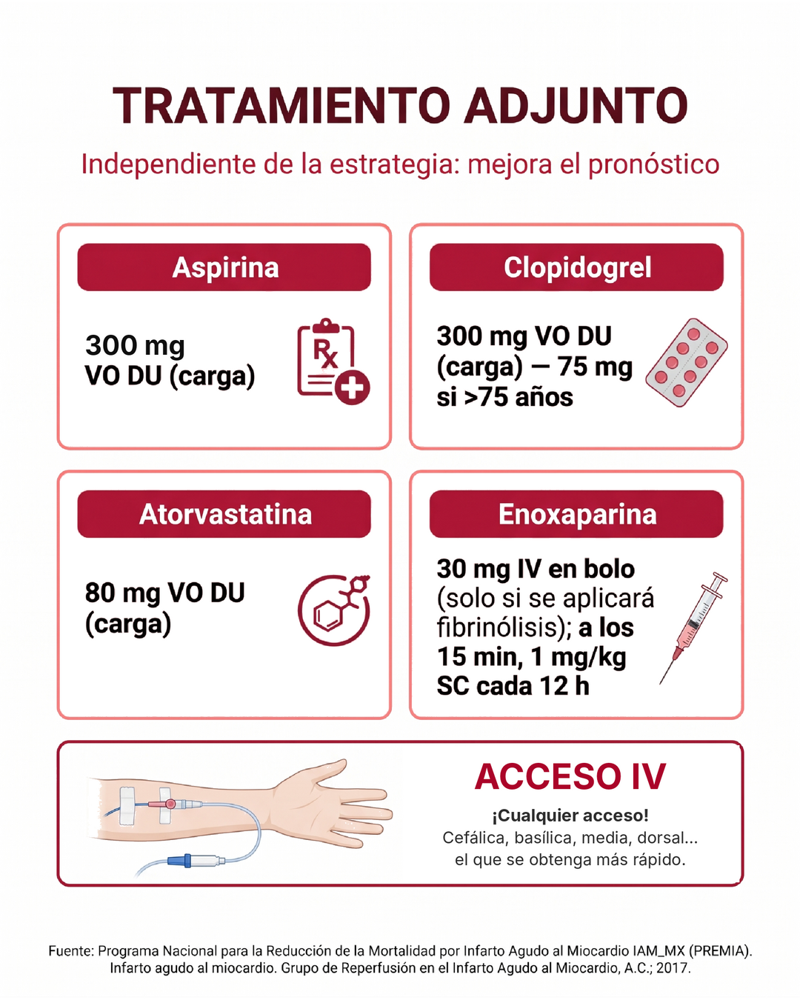 |
| 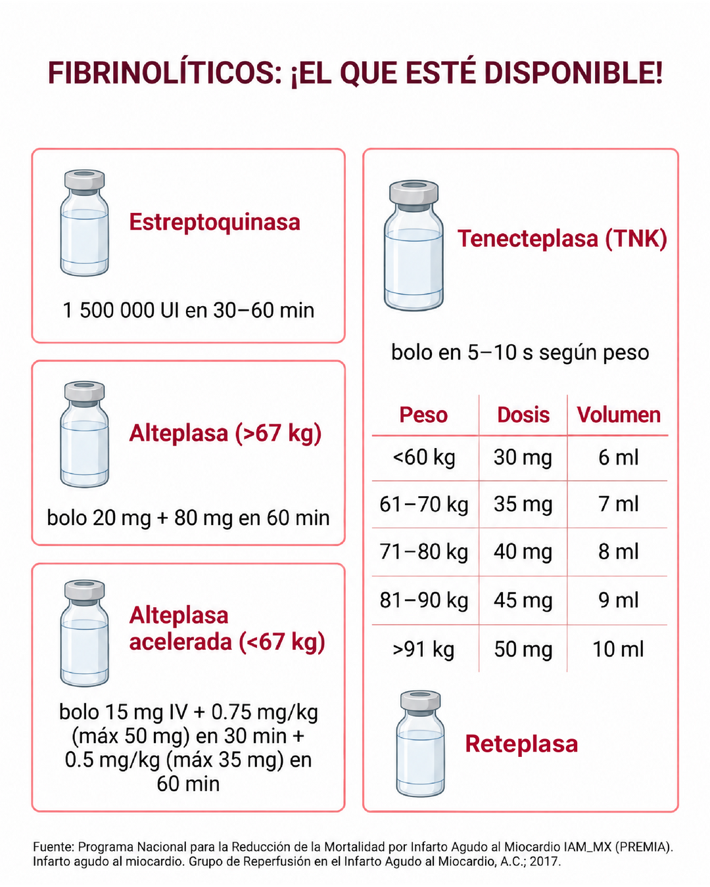 | 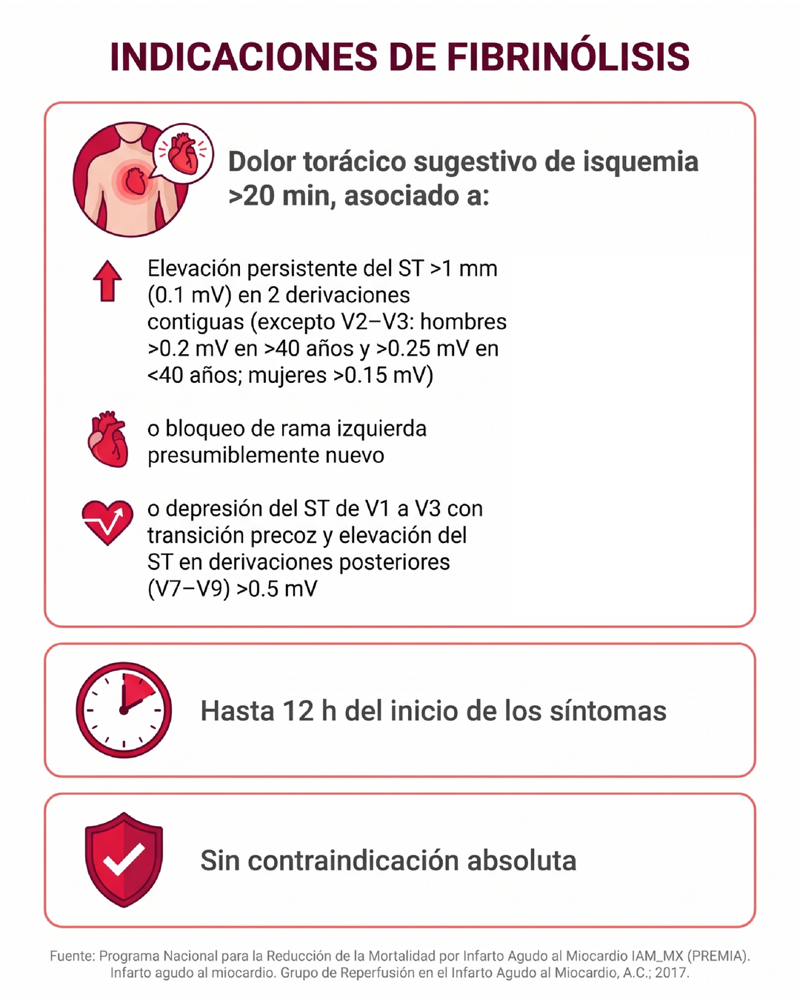 | 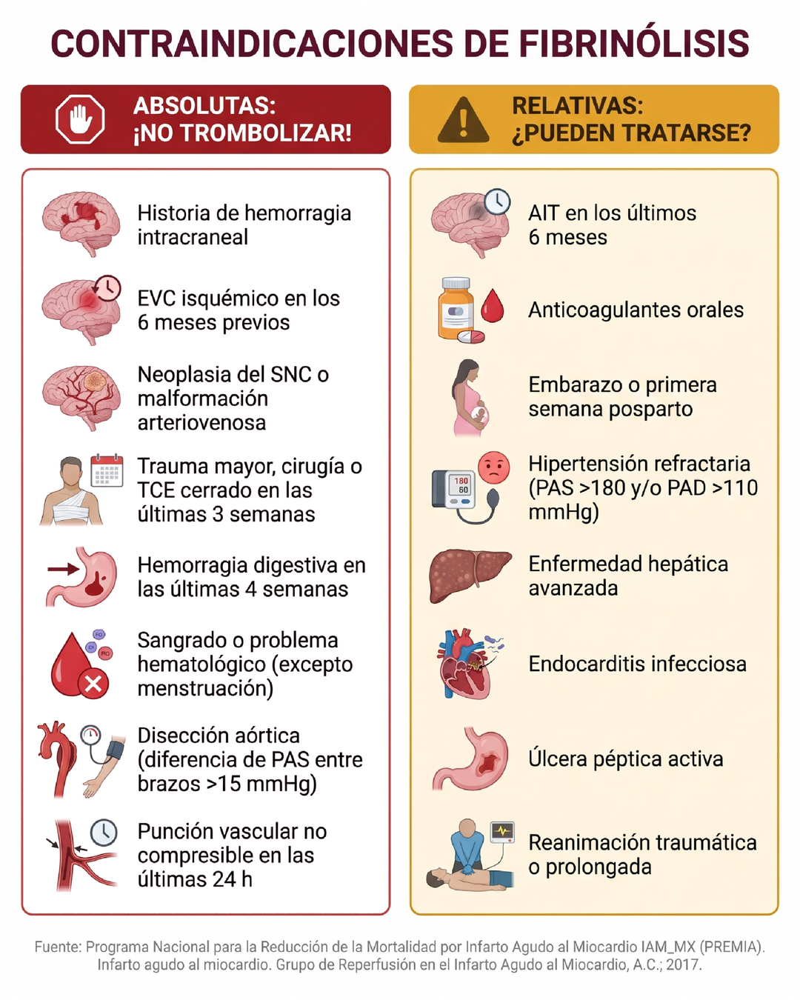 |

---

## 7. Cardiopatía isquémica crónica y miocardiopatía isquémica

### 7.1 Terminología y transición de la fase aguda a la crónica (iCARDIO Alliance 2026)

- **Cardiopatía isquémica crónica (CIC):** denominación tradicional de las manifestaciones estables de la aterosclerosis coronaria. La ESC introdujo en 2019 el término **síndromes coronarios crónicos**; ACC/AHA (2023) usan **enfermedad coronaria crónica**.
- **¿Cuándo pasa la fase aguda a la crónica?** Cuando el proceso trombótico agudo se ha resuelto y el paciente entra en un periodo de relativa estabilidad fisiopatológica.
- Por convención, la fase crónica inicia **12 meses después de un SCA**, cuando la tasa de eventos isquémicos recurrentes se estabiliza. Fase crónica **no** significa bajo riesgo: la aterosclerosis progresa y placas estables pueden volverse vulnerables.

> [!IMPORTANT]
> **La aterosclerosis es un padecimiento dinámico. Crónico no significa sin riesgo.**

### 7.2 Miocardiopatía isquémica

Disminución de la capacidad del corazón para bombear sangre por daño miocárdico causado por isquemia, casi siempre por enfermedad arterial coronaria. La isquemia breve produce pérdida **reversible** de contractilidad; la isquemia prolongada causa daño **irreversible**, fibrosis y remodelado, con disfunción ventricular, arritmias y alteraciones de la conducción. Suele cursar con **FEVI <40 %**.

**Factores de riesgo.** Modificables: diabetes, hipertensión, tabaquismo, dislipidemia, obesidad, sedentarismo. No modificables: edad, sexo, antecedentes familiares.

### 7.3 Presentación clínica

- Solo **10–25 %** de los pacientes estudiados presentan angina clásica (presión retroesternal con el esfuerzo o el estrés que mejora con reposo o nitroglicerina).
- La mayoría tiene síntomas inespecíficos: molestia torácica, dolor de garganta, brazo o mandíbula, náusea, disnea de esfuerzo, diaforesis o fatiga.
- **Mujeres:** síntomas no clásicos más frecuentes (dolor mandibular, epigástrico, náusea, fatiga), con subdiagnóstico y retraso diagnóstico. Escalas como SCORE2, PCE o PREVENT suelen subestimar su riesgo.
- **Adultos mayores:** pueden presentar síncope, delirium o disnea.
- Con insuficiencia cardíaca: disnea, ortopnea, intolerancia al ejercicio; estertores, galope S3, choque de punta desplazado, ingurgitación yugular, reflujo hepatoyugular y edema.

### 7.4 Evaluación

| Estudio | Utilidad |
|---|---|
| ECG en reposo (≤10 min en dolor agudo) | Isquemia actual, IM previo (ondas Q), trastornos de conducción, arritmias; V7–V9 y derivaciones derechas si se sospecha IM posterior |
| Troponina de alta sensibilidad | Descartar o confirmar lesión miocárdica rápidamente |
| CK-MB | Sospecha de reinfarto en IM reciente, incluido el posprocedimiento |
| Perfil de lípidos, creatinina, microalbuminuria, glucosa y HbA1c | Rutina; buscar causas reversibles (anemia, hipertiroidismo). La mioglobina ya no se recomienda |
| Lipoproteína(a) | Una vez en la vida; identifica riesgo de aterosclerosis temprana o grave |
| PCR de alta sensibilidad | Pronóstico; puede orientar la intensificación hipolipemiante o antiinflamatoria |
| BNP / NT-proBNP | Pronóstico e insuficiencia cardíaca |
| Radiografía de tórax | Cardiomegalia, congestión, líneas B de Kerley, derrame |
| Ecocardiograma transtorácico | FEVI, movilidad segmentaria, válvulas, pericardio |
| Prueba de esfuerzo o estrés farmacológico | Isquemia y, en algunas modalidades, viabilidad |
| Angiotomografía coronaria | Diagnóstico de enfermedad coronaria en riesgo bajo a intermedio |
| Coronariografía | Anatomía coronaria e intervención percutánea |
| Resonancia magnética (realce tardío con gadolinio) | Distingue miocardiopatía isquémica de no isquémica; sin realce tardío = potencial de recuperación |
| Medicina nuclear (sestamibi-99mTc) | Viabilidad: el miocardio hibernado mejora con revascularización |

### 7.5 Tratamiento

- **Estilo de vida:** dejar de fumar, ejercicio, dieta.
- **Revascularización:** reperfundir miocardio viable isquémico; en miocardiopatía isquémica, la cirugía de revascularización redujo la mortalidad total 7 % (absoluto) a 10 años frente al tratamiento médico.
- **Aspirina:** reduce morbilidad y mortalidad cardiovascular (dosis baja, 75–100 mg/día).
- **Estatina de alta intensidad:** atorvastatina 40–80 mg o rosuvastatina 20–40 mg diarios.
- **Betabloqueadores:** reducen la mortalidad en insuficiencia cardíaca; no iniciar en IC aguda descompensada.
- **IECA / ARA II / ARNI:** reducen la mortalidad en IC; ARNI (sacubitrilo/valsartán) superior a enalapril en PARADIGM-HF. Hidralazina + nitrato si no se toleran IECA ni ARA II.
- **Espironolactona:** reduce morbimortalidad en IC con FEVI ≤35 % (NYHA III–IV).
- **Digoxina:** mejora síntomas y hospitalizaciones, no la mortalidad.
- **Ranolazina:** antiisquémica y antiarrítmica.
- **DAI:** prevención de muerte súbita con FEVI ≤35 % y NYHA II–III (≥40 días post-IM o 3 meses tras revascularización), o FEVI ≤30 % con NYHA I.
- **Terapia de resincronización:** FEVI ≤35 % con síntomas pese a revascularización y tratamiento óptimo.
- **Trasplante cardíaco:** cuando la enfermedad progresa sin respuesta.

**Diagnóstico diferencial:** miocardiopatía de Takotsubo, tirotoxicosis, beriberi, taponamiento, toxicidad por metales pesados, miocardiopatía hipertrófica avanzada, miocarditis, miocardiopatía restrictiva.

**Pronóstico:** depende de la viabilidad miocárdica; mayor viabilidad se asocia a mejores resultados tras la revascularización.

### 7.6 Figuras (iCARDIO Alliance 2026)

| | |
|---|---|
| 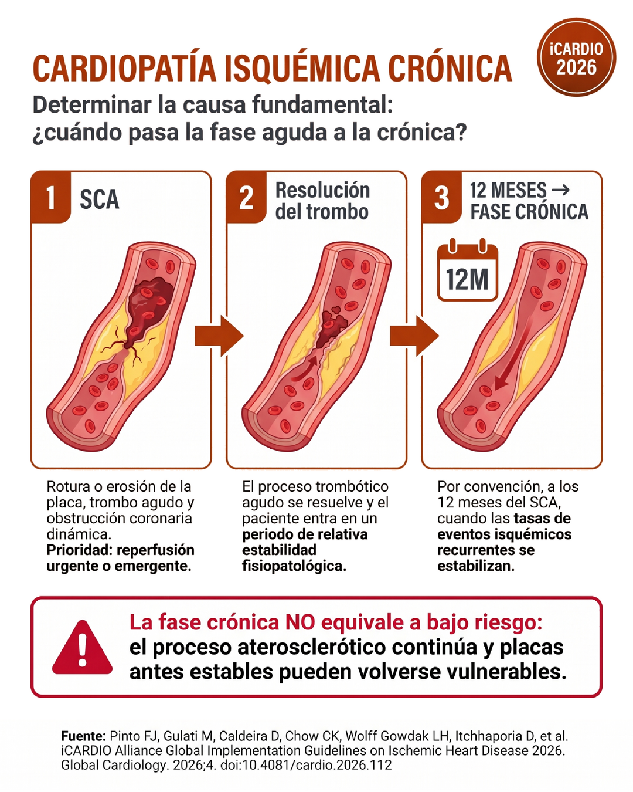 | 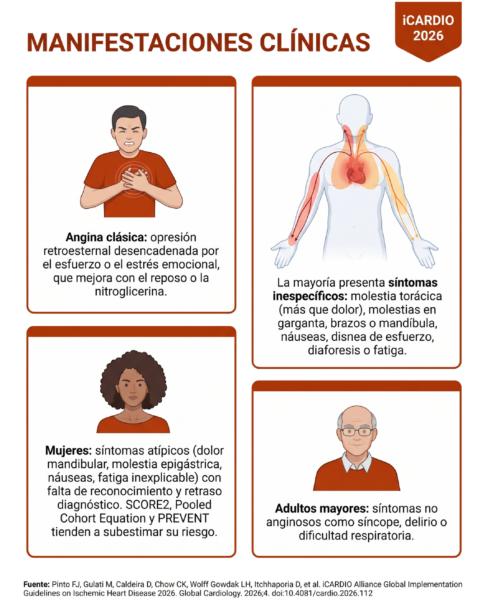 |
| 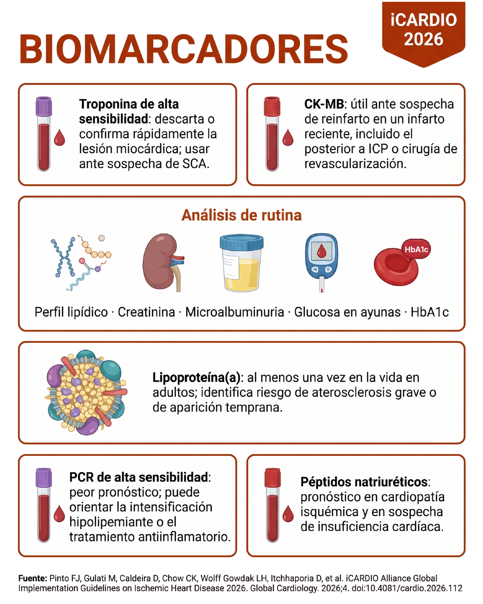 | 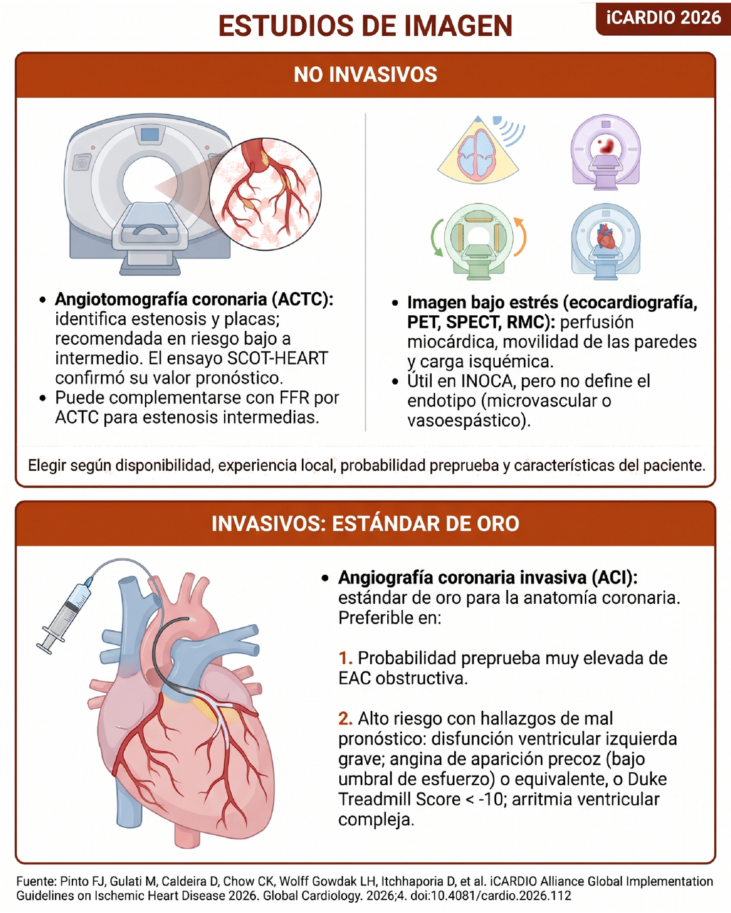 |

---

## 8. Resumen: iCARDIO Alliance 2026

Guía global de implementación sobre cardiopatía isquémica:

1. **Del agudo al crónico:** el SCA se caracteriza por rotura o erosión de placa, trombosis y obstrucción dinámica que exigen reperfusión urgente; la fase crónica comienza por convención a los 12 meses. La aterosclerosis es un padecimiento dinámico: crónico no significa sin riesgo.
2. **Enfoque crónico:** identificación adecuada, estratificación de riesgo, prevención secundaria a largo plazo y revascularización cuando está indicada.
3. **Terapia antitrombótica:** pilar de la prevención secundaria; su elección, intensidad, duración y adaptación dependen del equilibrio entre riesgo isquémico y hemorrágico, comorbilidades y tiempo desde el evento agudo.
4. **Síntomas:** la angina clásica es minoritaria (10–25 %); vigilar presentaciones atípicas en mujeres y adultos mayores.
5. **Biomarcadores:** troponina de alta sensibilidad para el SCA; CK-MB para reinfarto reciente; lípidos, creatinina, microalbuminuria, glucemia y HbA1c de rutina; Lp(a) una vez en la vida; PCR-as y péptidos natriuréticos para pronóstico.
6. **ECG en <10 min** en todo dolor torácico agudo; ECG seriados y derivaciones posteriores o derechas cuando el ECG inicial no es diagnóstico.

---

## 9. Choque cardiogénico

> Esta sección se basa en Gopar-Nieto R, et al. Arch Cardiol Mex. 2026 (referencia 12).

### 9.1 Definición

El choque cardiogénico (CC) es la forma más grave de hipoperfusión ocasionada por disfunción cardiaca, con **disminución del gasto cardiaco** y **elevación de las presiones de llenado intracavitarias**. Se define como un gasto cardiaco ineficaz por disfunción cardiaca que genera manifestaciones clínicas y bioquímicas de hipoperfusión.

| Clínicas | Bioquímicas |
|---|---|
| Sudoración, extremidades frías, oliguria (<30 mL/h), mareo, confusión mental, pulsos distales disminuidos | Acidosis metabólica, ↑ creatinina, lactato >2.0 mmol/L |

> [!CAUTION]
> Una **PAS <90 mmHg por >30 min** o la necesidad de aminas vasoactivas también es criterio, pero puede no estar presente en etapas tempranas del CC.

### 9.2 Epidemiología

- **80 %** se debe a síndromes coronarios agudos y **20 %** a insuficiencia cardiaca.
- **4–12 %** de los pacientes con SCA desarrolla CC: 30–40 % se detecta al ingreso y 60–70 % durante la hospitalización.
- En México, en un centro de referencia, el CC constituyó el **3.7 %** de todos los ingresos durante 13 años.
- Mortalidad intrahospitalaria: **~40 %** en países desarrollados y **hasta 70 %** en países en vías de desarrollo.
- En sobrevivientes, la mortalidad al primer año llega a **50–60 %**; el 70–80 % ocurre en los primeros 30–60 días.
- En México los datos son insuficientes: se requiere mejor registro estadístico y equipos de choque interdisciplinarios en los hospitales.

### 9.3 Fisiopatología

La disfunción de la microvasculatura y el síndrome de respuesta inflamatoria sistémica (SRIS) disminuyen el gasto cardiaco; la hipoperfusión y la sobrecarga de volumen retroalimentan la inflamación y, si el ciclo no se detiene, aparece **falla multiorgánica**.

- **En SCA:** pérdida de miocardio → ↓ contractilidad del VI → vasoconstricción compensadora → ↑ presión venosa central y desacoplamiento veno-arterial → congestión e inflamación que perpetúan el ciclo.
- **En IC:** ciclos repetidos de inflamación y mal acoplamiento de volumen → descompensaciones frecuentes → hipoperfusión y congestión.

> [!IMPORTANT]
> La microcirculación precede y determina a la macrocirculación: hasta el **45 %** de quienes mueren por CC tiene un índice cardiaco **≥2.2 L/min/m²**. Hay repercusión cerebral, renal, hepática, gastrointestinal y respiratoria.

### 9.4 Abordaje y estratificación del riesgo

Actuar de inmediato en pacientes de riesgo: infarto reciente con amplia extensión eléctrica o insuficiencia cardiaca conocida.

| Fase | Características |
|---|---|
| Prechoque | Hipoperfusión (extremidades frías, oliguria, ↑ lactato, acidosis) aun con PAS >90 mmHg; ↑ resistencias vasculares periféricas y taquicardia compensadoras |
| Choque | Hipoperfusión + hipotensión, ↑ presiones de llenado, congestión sistémica |
| Choque refractario | Hipoperfusión que no responde a las estrategias establecidas |

**Clasificación SCAI (2019):** A (*At risk*) en riesgo; B (*Beginning*) prechoque; C (*Classic*) hipoperfusión + hipotensión; D (*Deteriorating*) requiere escalar terapia; E (*Extremis*) colapso circulatorio.

**Valoración triaxial (consenso de expertos del ACC):** 1) etapa SCAI; 2) fenotipo clínico (cardiogénico puro, mixto o distributivo); 3) modificadores de riesgo (edad, comorbilidad, lactato elevado, disfunción multiorgánica).

### 9.5 Tratamiento

- **Paradigma:** descargar el VI y dar soporte hemodinámico. Ninguna de estas terapias ha demostrado reducir la mortalidad a corto plazo.
- **CC por SCA:** reperfusión de la arteria responsable del infarto y soporte para permitir la recuperación ventricular.
- **Tres fases:** 1) **rescate**: mantener la PA y estabilizar; 2) **optimización**: ajustar fármacos según la perfusión tisular y considerar asistencia ventricular y ventilación; 3) **retiro**: reducir fármacos y asistencia.
- **Vasoactivos:** se usan en el 90 % de los pacientes; mantienen la PA y el inotropismo, pero aumentan el consumo miocárdico de O₂ y el riesgo de arritmias.

| Escenario | Hipotensión | Normotensión |
|---|---|---|
| SCA | Norepinefrina | Dobutamina, milrinona o levosimendán |
| IC descompensada | Norepinefrina | Dobutamina, milrinona, levosimendán o epinefrina + nitroprusiato |
| Falla del VD | Norepinefrina | Milrinona o levosimendán |

### 9.6 Figuras

| | |
|---|---|
| 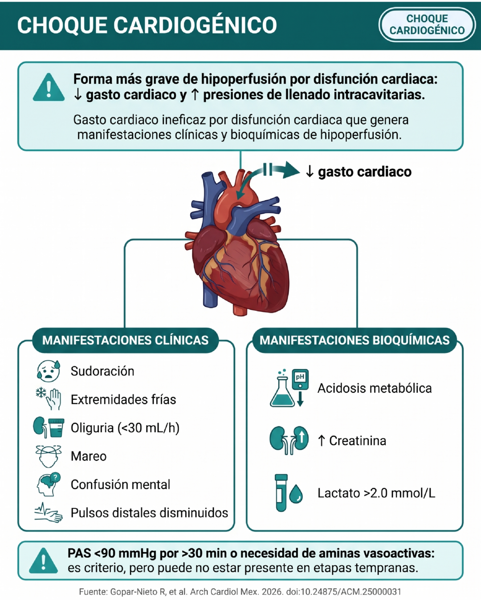 | 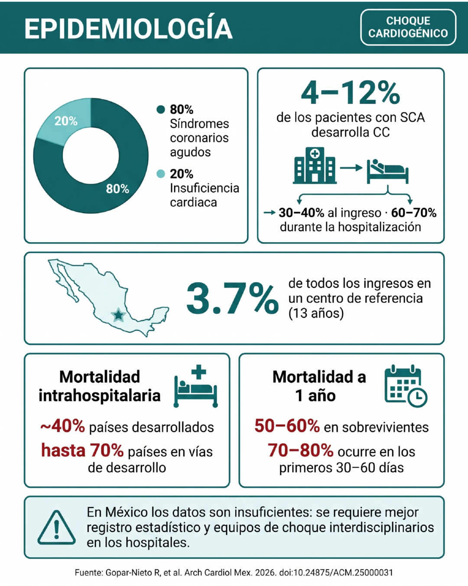 |
| 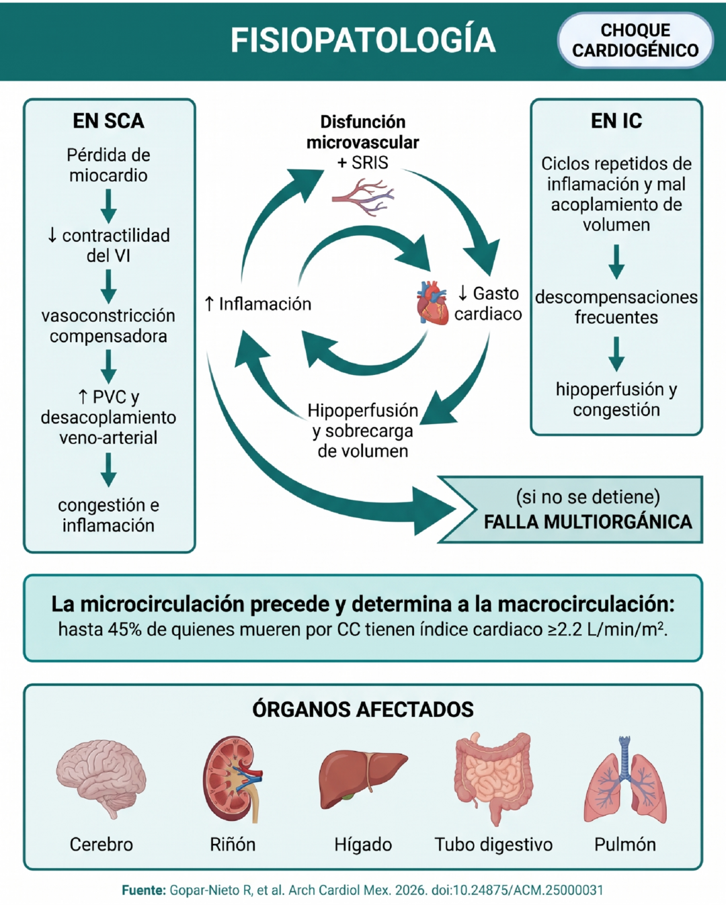 | 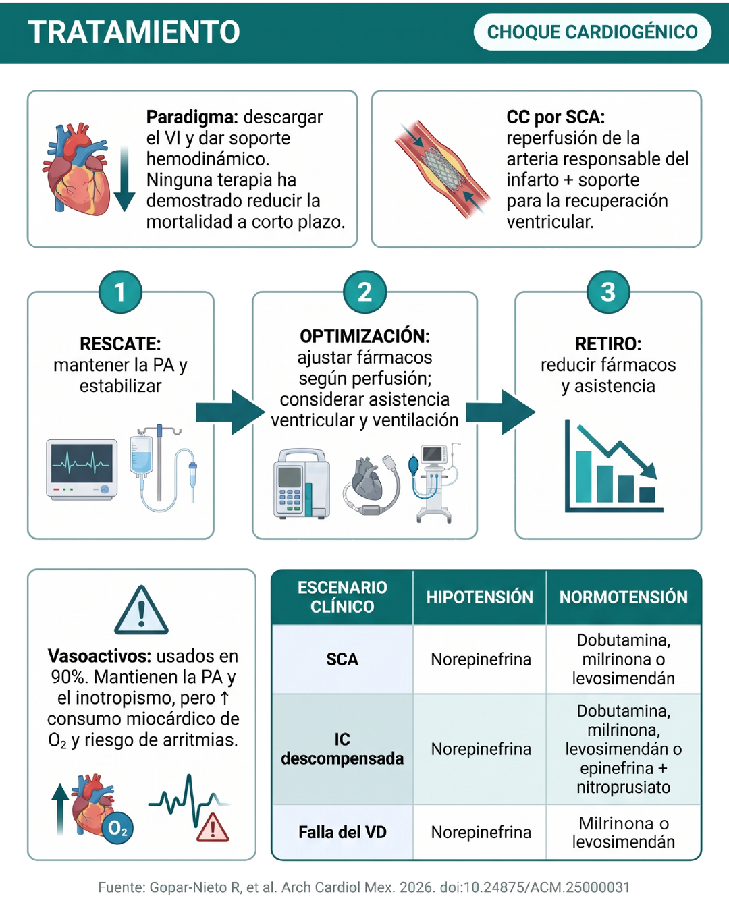 |

---

## 10. Referencias

1. Instituto Nacional de Estadística y Geografía (INEGI). Estadísticas de Defunciones Registradas (EDR), enero a marzo de 2026 (preliminar). Comunicado 36/26; 18 de septiembre de 2026. https://www.inegi.org.mx/contenidos/saladeprensa/boletines/2026/edr/EDR2026-1erT_RR.pdf
2. OCDE. Health at a Glance 2025: nota de país, México. https://www.oecd.org/content/dam/oecd/es/publications/reports/2025/11/health-at-a-glance-2025-country-notes_2f94481e/mexico_0c55bf71/42bdb5b4-es.pdf
3. Moguel-Ancheita R, Arce-Piña L, Lozoya-Morales JJ, Ramos-Cházaro E, Cuevas-Cueto D, Lozoya-del-Rosal JJ, et al. Consenso Mexicano sobre la Cardiopatía Isquémica Crónica. Diagnóstico, clasificación y estratificación no invasivos. COMECITE. Cardiovasc Metab Sci. 2021;32(s4):s317-s346. https://dx.doi.org/10.35366/101973
4. Mills NL, Newby LK, Zaman S, et al. Fifth Universal Definition of Myocardial Infarction (2026). Circulation. 2026. https://doi.org/10.1161/CIR.0000000000001477
5. Byrne RA, Rossello X, Coughlan JJ, et al. 2023 ESC Guidelines for the management of acute coronary syndromes. Eur Heart J. 2023;44(38):3720-3826. https://doi.org/10.1093/eurheartj/ehad191
6. Jerjes-Sánchez C, Martínez-Sánchez C, Borrayo-Sánchez G, Carrillo-Calvillo J, Juárez-Herrera U, Quintanilla-Gutiérrez J. Tercer Registro Nacional de Síndromes Coronarios Agudos (RENASICA III). Arch Cardiol Mex. 2015;85(3):207-14. https://doi.org/10.1016/j.acmx.2015.04.001
7. Savonitto S, Alpert JS, Thiele H, et al. Non-ST-segment elevation acute coronary syndrome: understanding the full spectrum to guide management. Eur Heart J. 2026;47(4):423-437. https://doi.org/10.1093/eurheartj/ehaf958
8. Programa Nacional para la Reducción de la Mortalidad por Infarto Agudo al Miocardio IAM_MX (PREMIA). Infarto agudo al miocardio. Grupo de Reperfusión en el Infarto Agudo al Miocardio, A.C.; 2017. https://calidad.salud.gob.mx/site/iam/docs/iam_01.pdf
9. Bhandari B, Quintanilla Rodriguez BS, Saad Eddin A, et al. Ischemic Cardiomyopathy. [Actualizado 31 jul 2023]. En: StatPearls. Treasure Island (FL): StatPearls Publishing; 2023. https://www.ncbi.nlm.nih.gov/books/NBK537301/
10. Pinto FJ, Gulati M, Caldeira D, Chow CK, Wolff Gowdak LH, Itchhaporia D, et al. iCARDIO Alliance Global Implementation Guidelines on Ischemic Heart Disease 2026. Global Cardiology. 2026;4. https://doi.org/10.4081/cardio.2026.112
11. Rao SV, O'Donoghue ML, Ruel M, et al. 2025 ACC/AHA/ACEP/NAEMSP/SCAI Guideline for the Management of Patients With Acute Coronary Syndromes: A Report of the American College of Cardiology/American Heart Association Joint Committee on Clinical Practice Guidelines. J Am Coll Cardiol. 2025;85(22):2135-2237. https://doi.org/10.1016/j.jacc.2024.11.009
12. Gopar-Nieto R, García-Villarejo M, Arias-Escarpulli R, et al. ¿Cómo abordar y tratar el choque cardiogénico? Actualización y perspectivas sobre el tratamiento farmacológico y mecánico. Arch Cardiol Mex. 2026. https://doi.org/10.24875/ACM.25000031
