# Ischemic heart disease: a guide for medical students and clinicians

> Educational material. It does not replace clinical judgment or current institutional guidelines.

**Contents**

1. [Epidemiology in Mexico](#1-epidemiology-in-mexico)
2. [Myocardial infarction: Fifth Universal Definition (2026)](#2-myocardial-infarction-fifth-universal-definition-2026)
3. [Acute coronary syndromes (ACS): 2023 ESC Guidelines](#3-acute-coronary-syndromes-acs-2023-esc-guidelines)
4. [Non-ST-elevation ACS (NSTE-ACS / NSTEMI)](#4-non-st-elevation-acs-nste-acs--nstemi)
5. [ACS according to the 2025 ACC/AHA Guideline](#5-acs-according-to-the-2025-accaha-guideline)
6. [ST-elevation MI (STEMI): the ICAT3 protocol](#6-st-elevation-mi-stemi-the-icat3-protocol)
7. [Chronic ischemic heart disease and ischemic cardiomyopathy](#7-chronic-ischemic-heart-disease-and-ischemic-cardiomyopathy)
8. [Summary: iCARDIO Alliance 2026](#8-summary-icardio-alliance-2026)
9. [Cardiogenic shock](#9-cardiogenic-shock)
10. [References](#10-references)

The figures for sections 3 to 9 are the original Spanish-language teaching slides.

---

## 1. Epidemiology in Mexico

**INEGI.** Heart diseases are the **leading cause of death in Mexico in both men and women**. In the first quarter of 2026, 49,252 deaths from heart disease were registered out of 207,599 total deaths (22,848 women and 26,397 men), ahead of diabetes mellitus and malignant tumors.

**OECD, *Health at a Glance 2025* (Mexico country note).**

| Indicator | Mexico | OECD average |
|---|---|---|
| Preventable mortality (per 100,000) | 243 | 145 |
| Treatable mortality (per 100,000) | 175 | 77 |
| Daily smokers | 8.5 % | 14.8 % |
| Adults with insufficient physical activity | 28 % | 30 % |
| 30-day mortality after AMI (unlinked data) | **22.6 %** | 6.5 % |
| 30-day mortality after stroke | 17.0 % | 7.7 % |

Mexico ranks second in obesity and first in obesity and overweight combined.

> 30-day mortality after AMI in Mexico is more than three times the OECD average: the problem is not only how common the disease is, but **time and access to reperfusion** (see section 5).

**Mexican Consensus on Chronic Ischemic Heart Disease (COMECITE, 2021).**

- Ischemic heart disease has a prevalence of about **30 % in adults over 40** in Mexico and is the leading cause of death.
- Diagnostic approach, risk stratification and selection for cardiac catheterization vary between public and private care and with available technology, regardless of ACC/AHA guidelines.
- Distinguishing **acute from chronic coronary syndromes** is essential.

---

## 2. Myocardial infarction: Fifth Universal Definition (2026)

The Fifth Universal Definition of Myocardial Infarction (ESC/ACC/AHA/WHF, 2026) updates the classification to align it with pathophysiology, clinical evaluation and objective diagnostic criteria, and for the first time aligns with ICD-11 coding.

### 2.1 Definition

- **Pathological:** myocardial cell death due to prolonged ischemia (insufficient or absent coronary flow) and reperfusion injury. Histopathological diagnosis requires autopsy.
- **Clinical:** based on clinical presentation, biomarkers, the electrocardiogram and coronary or cardiac imaging. It requires **indirect evidence of irreversible cell death** and confirmation that the cell death was **caused by myocardial ischemia**.
- **No single criterion** confirms the diagnosis: several criteria are needed that together increase the probability of infarction.

### 2.2 Myocardial injury ≠ infarction

- **Myocardial injury:** cardiac troponin above the **sex-specific 99th percentile upper reference limit (URL)**.
  - **Acute:** rise and/or fall of troponin on serial measurements.
  - **Chronic:** persistently elevated troponin due to an underlying cardiac condition or a non-cardiac condition associated with remodeling.
- **Acute myocardial infarction:** acute myocardial injury **plus** evidence of ischemia (≥1):
  - symptoms of ischemia;
  - ischemic ECG changes;
  - new loss of viable myocardium on imaging;
  - coronary thrombus.

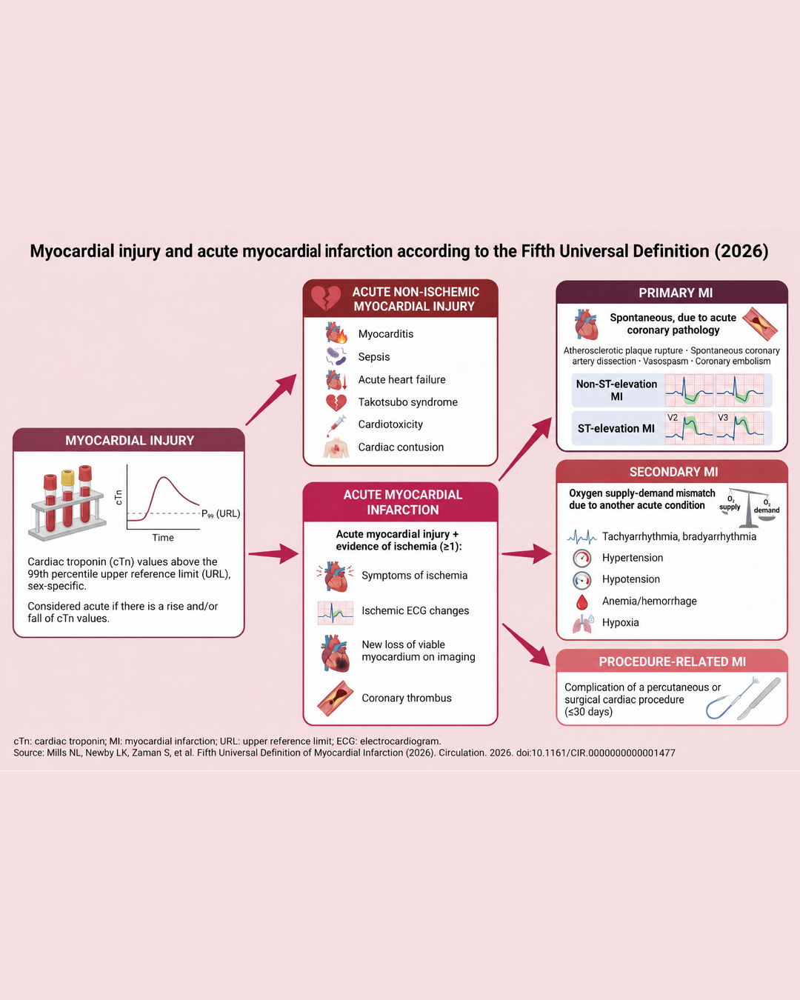

### 2.3 Three clinical contexts of MI (replacing types 1 to 5)

| Fifth Definition (2026) | Previously (Fourth, 2018) | Description |
|---|---|---|
| **Primary MI** | Type 1 | Spontaneous, due to acute coronary pathology. Mostly atherothrombosis; other causes (spontaneous coronary artery dissection, vasospasm, coronary embolism) are identified with coronary imaging and functional testing. |
| **Secondary MI** | Type 2 | Consequence of another acute condition causing oxygen supply–demand imbalance. Objective criteria are proposed to guide cardiac and coronary imaging. |
| **Procedure-related MI** | Types 4 and 5 | Complication of a percutaneous or surgical cardiac procedure (≤30 days). |

**MINOCA** now stands for myocardial *injury* (not infarction) with non-obstructive coronary arteries: it is a **working diagnosis**, not a final one.

### 2.4 Mechanisms of myocardial injury

**Acute (Table 2):**

| Mechanism | Conditions |
|---|---|
| Ischemia | Myocardial infarction |
| Inflammation | Myocarditis (autoimmune, infectious, toxic); heart transplant rejection; cytokine-mediated in sepsis |
| Hemodynamic stress | Supply–demand imbalance*; tachy- or brady-arrhythmia; acute heart failure; acute pulmonary embolism; malignant hypertension |
| Physiological stress | Strenuous exercise |
| Catecholamine stress | Takotsubo syndrome; subarachnoid hemorrhage; stroke; epileptic seizures; pheochromocytoma |
| Toxicity | Anthracyclines; ErbB-targeted therapies; tyrosine kinase inhibitors; immune checkpoint inhibitors; radiation-induced |
| Trauma | Electrical cardioversion; percutaneous coronary or structural intervention; catheter ablation or device implantation; cardiac surgery; cardiac contusion |

\*Any acute condition causing myocardial oxygen imbalance through reduced supply (hypoxia, anemia, hypotension) and/or increased demand (tachycardia, hypertension).

**Chronic (Table 3):**

| Mechanism | Conditions |
|---|---|
| Ischemia | Chronic coronary syndrome; ischemic cardiomyopathy |
| Other cardiomyopathies | Hypertrophic; hypertensive; dilated; chronic inflammatory; restrictive; infiltrative; uremic in chronic kidney disease |
| Hemodynamic stress | Chronic heart failure; systemic hypertension; pulmonary hypertension |
| Structural | Valvular heart disease; congenital heart disease; cardiac tumor |

| Acute injury | Chronic injury |
|---|---|
| 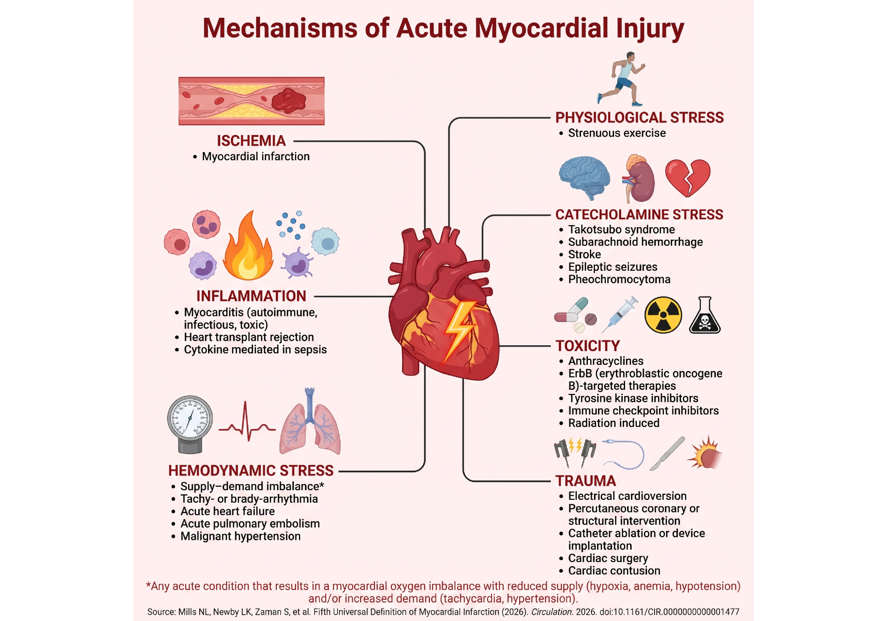 | 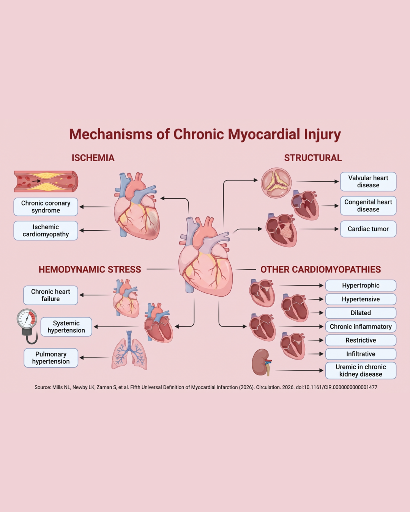 |

---

## 3. Acute coronary syndromes (ACS): 2023 ESC Guidelines

**Acute coronary syndromes (ACS)** encompass a spectrum of conditions in patients with recent changes in clinical symptoms or signs, with or without changes on the 12-lead ECG, and with or without acute elevations in cardiac troponin (cTn). Patients with suspected ACS may eventually be diagnosed with **acute myocardial infarction (AMI)** or **unstable angina (UA)**.

### 3.1 Classification

```
                      ACUTE CORONARY SYNDROME
                               │
            ┌──────────────────┴──────────────────┐
     Unstable angina (UA)          Acute myocardial infarction (AMI)
     ischemia without necrosis                     │
                                    ┌──────────────┴──────────────┐
                                  STEMI                         NSTEMI
                          (ST-segment elevation)     (no ST-segment elevation)
```

- **Unstable angina:** myocardial ischemia at rest or on minimal exertion, **without** acute cardiomyocyte injury or necrosis. It presents as prolonged (>20 min) angina at rest; new-onset severe angina; angina increasing in frequency or duration or occurring at progressively lower exertion; or angina after a recent MI.
- **Acute myocardial infarction:** cardiomyocyte necrosis in a clinical setting of acute myocardial ischemia. It is subdivided by ECG into **STEMI** and **NSTEMI**.
- **Myocardial injury:** troponin release by mechanisms that do not meet the criteria for infarction. It may be acute or chronic depending on dynamic changes in serial measurements. Causes: myocarditis, sepsis, Takotsubo cardiomyopathy, valvular disease, arrhythmias and heart failure (HF).

### 3.2 Clinical presentations

Asymptomatic patients · persistent chest discomfort or symptoms (chest and precordial pain) · cardiac arrest · electrical or hemodynamic instability · cardiogenic shock.

### 3.3 Initial management

1. Patients with suspected ACS are classified by the **ECG at presentation**.
2. The classification may change with the presence or absence of **troponin elevation**.
3. ECG and troponin are central to triage, diagnosis, risk stratification and the initial strategy.
4. After the acute phase and stabilization, most subsequent treatment is **common to all ACS** and can follow a common protocol.

| | |
|---|---|
| 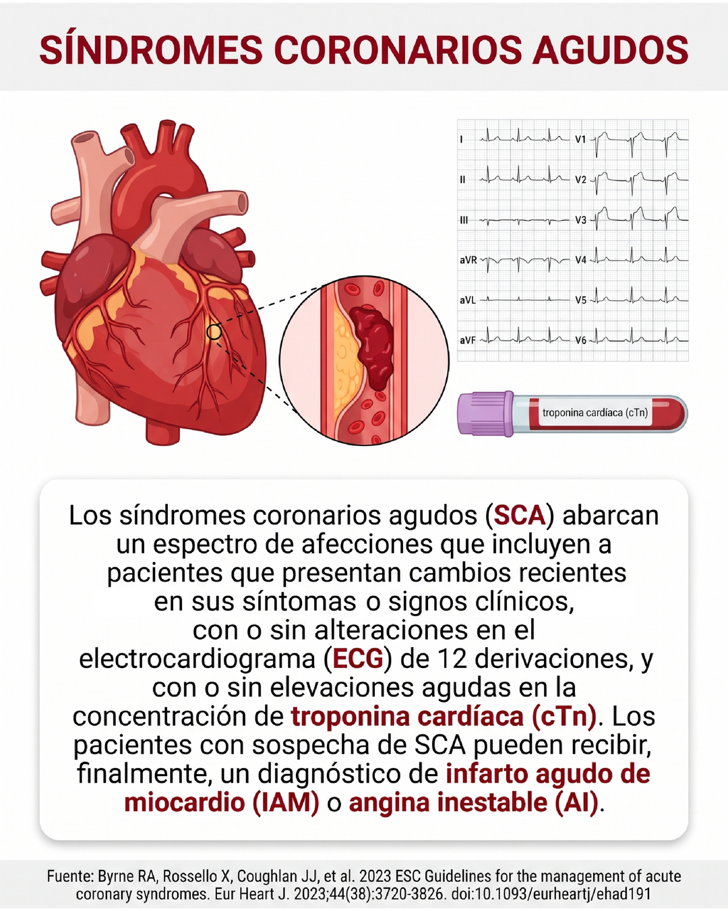 | 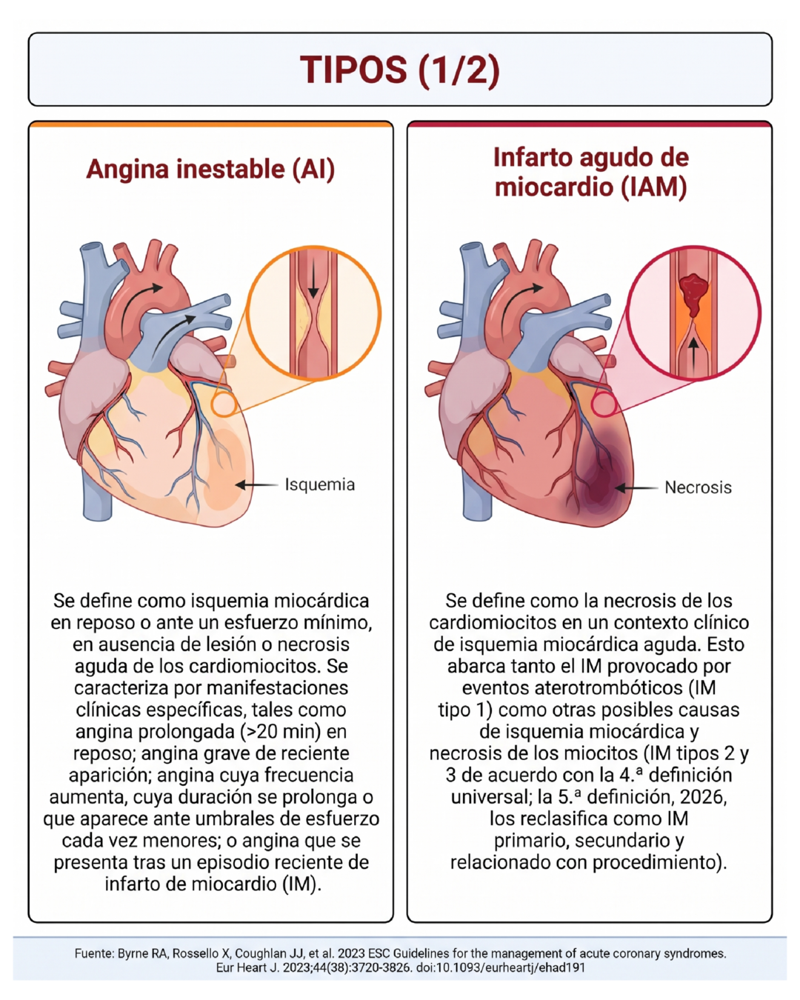 |
| 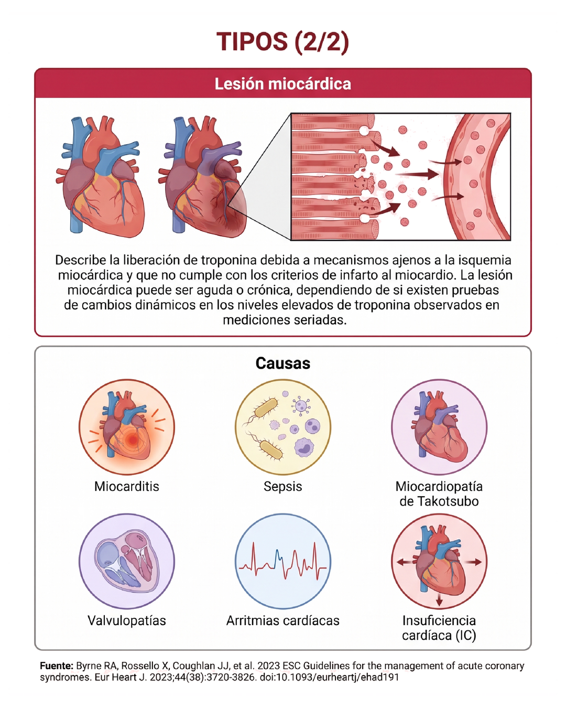 | 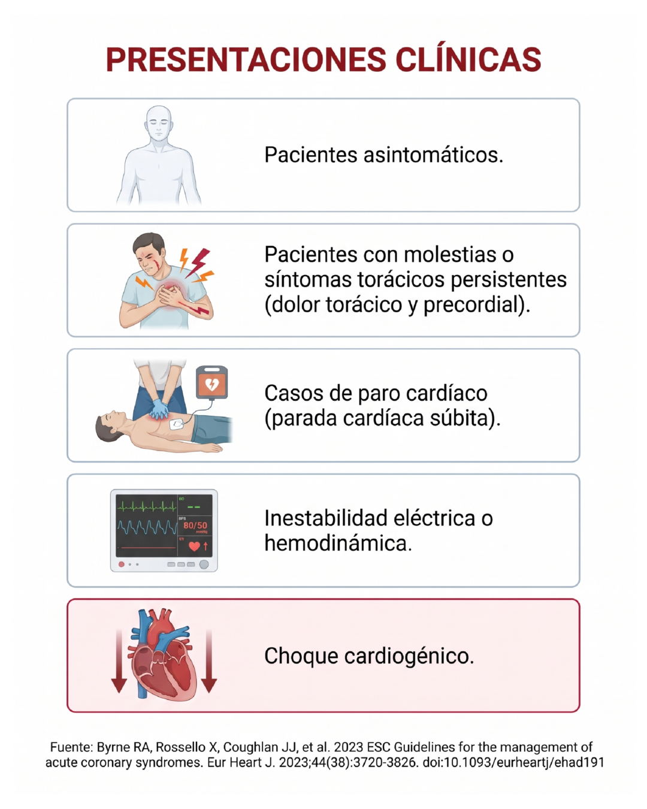 |

### 3.4 The ECG in ACS: RENASICA III

The **Third Mexican National Registry of Acute Coronary Syndromes (RENASICA III)** classifies ACS by ECG into four groups:

| Group | Criterion |
|---|---|
| Normal or nonspecific | ST depression <0.05 mV or asymmetric negative T wave <0.2 mV; ventricular hypertrophy; paced rhythm |
| ST depression | >0.05 mV in two contiguous leads or symmetric negative T wave >0.2 mV |
| Transient ST elevation | J point with positive slope (>0.2 mV in V1–V3 and >0.1 mV in other leads) in two contiguous leads, with ST normalization or residual deep negative T wave, spontaneously or after treatment |
| Persistent ST elevation | J point with positive slope (>0.2 mV in V1–V3 and >0.1 mV in other leads) in two contiguous leads |

The 2023 ESC guidelines use sex- and age-specific ST-elevation thresholds in V2–V3.

**Infarction with left bundle branch block.** Mexican school of electrocardiography (Sodi-Pallares): Q wave in I, aVL, V5 or V6 suggests septal infarction; loss of QRS voltage with Q waves in V4–V6 may indicate anteroseptal infarction; RS or rs with negative T in V4–V6 may reflect transmural infarction. Sgarbossa: **concordant** ST elevation ≥1 mm in leads with an R wave, or ST depression ≥1 mm in V1–V3; **discordant** ST elevation ≥5 mm in leads with an S wave.

**STEMI criteria (RENASICA III):** chest pain or discomfort ≥20 min (or equivalent); ECG with persistent ST elevation >1 mm in ≥2 contiguous leads, left bundle branch block, or tall R in V1–V2 with ST depression in V1–V3 and right-sided leads; elevated biomarkers (preferably troponin) above the 99th percentile; echocardiogram with new wall motion abnormality. Evidence of ischemia: objective documentation by echocardiography or nuclear imaging.

| | |
|---|---|
| 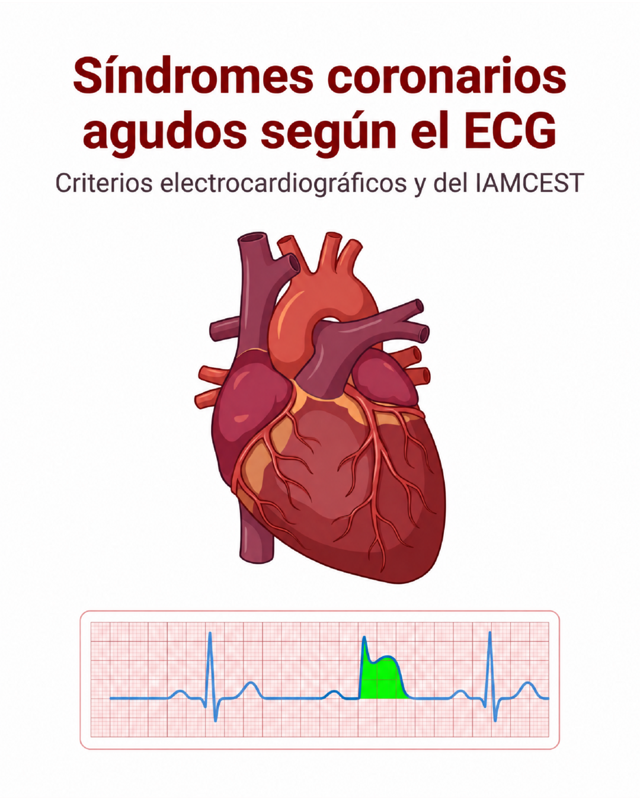 | 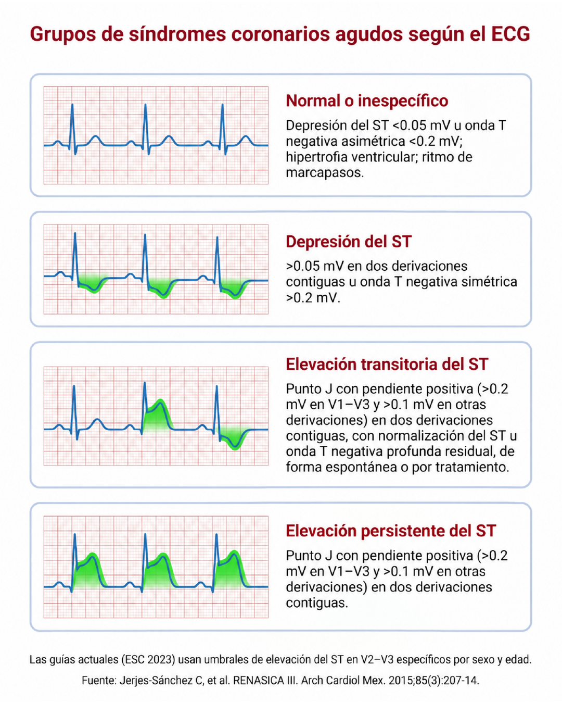 |
| 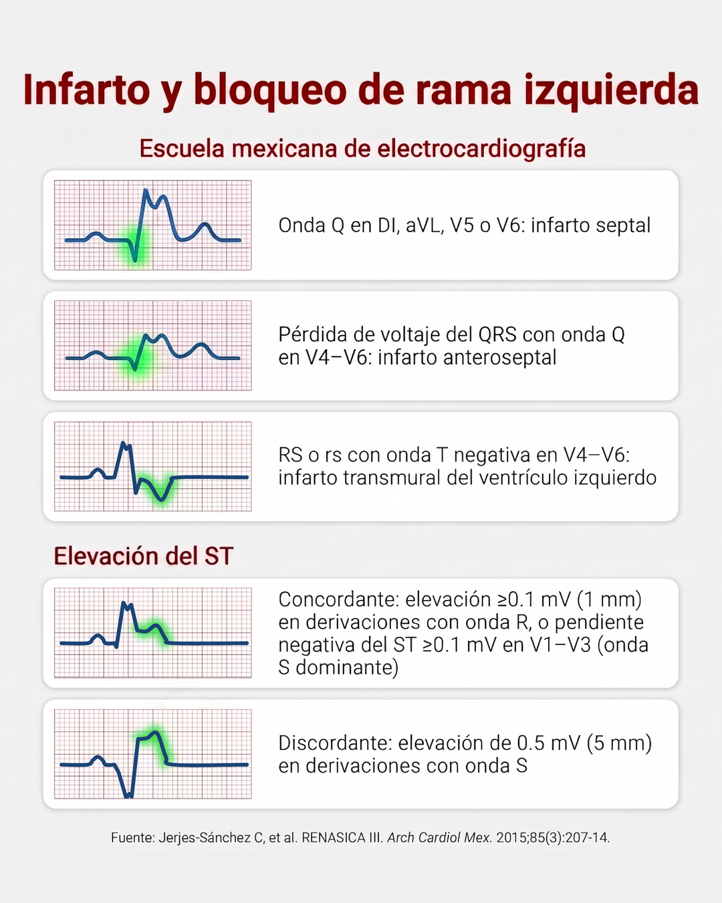 | 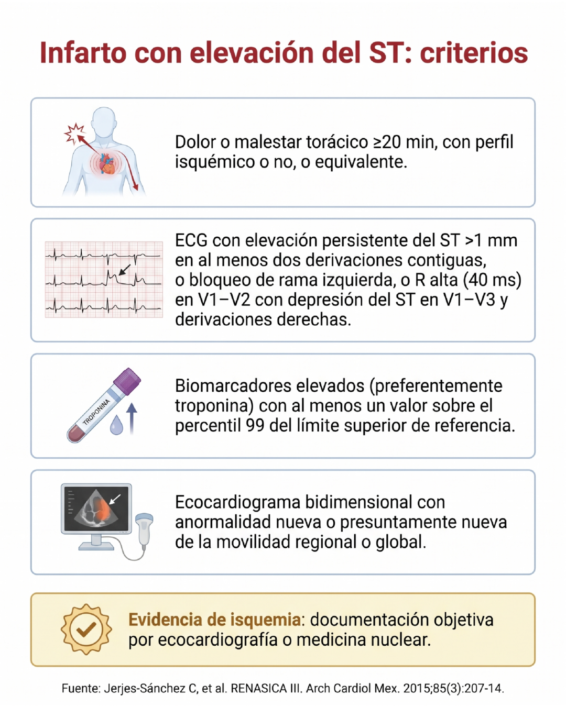 |

### 3.5 Systems of care in Mexico

- **ICAT3:** the Mexican protocol for STEMI treatment (National Program IAM_MX / PREMIA). Developed in [section 6](#6-st-elevation-mi-stemi-the-icat3-protocol).
- **Código Infarto:** the Mexican Social Security Institute (IMSS) institutional protocol for STEMI care.

---

## 4. Non-ST-elevation ACS (NSTE-ACS / NSTEMI)

- **NSTEMI** is more frequent than STEMI in **older adults**, as a consequence of long-standing coronary disease with established collateral circulation.
- **High-sensitivity troponin (hs-cTn)** assays have markedly reduced the proportion of patients ultimately classified as unstable angina rather than NSTEMI.

### 4.1 Clinical evaluation

- Symptoms and signs of **heart failure** and elevated **NT-proBNP** are important for initial diagnosis, risk stratification and immediate treatment.
- Baseline **creatinine** and **hemoglobin** have therapeutic and prognostic implications.
- Advanced age, risk factors, prior cardiovascular events and current treatment help define the diagnosis.

### 4.2 The ECG

- The 12-lead ECG is central at every stage of management.
- A small minority show **transient ST elevation (<30 min)**.
- Symptoms may have resolved by first medical contact: obtain **serial ECGs**, especially if symptoms recur, since they often reveal dynamic changes.
- In NSTE-ACS: **~40 %** have no ischemic ECG changes; **~30 %** have ST depression; **~30 %** have T-wave changes, isolated or with ST depression.

### 4.3 Dual antiplatelet therapy (DAPT)

- Platelets play a central role in ACS pathogenesis, which justifies antiplatelet therapy in the acute phase and to reduce recurrent MI and stent thrombosis.
- **CURE trial:** aspirin + clopidogrel (median 9 months) reduced the composite of cardiovascular death, non-fatal MI or stroke by **20 %** versus aspirin alone in NSTE-ACS, at the cost of a **38 %** increase in major bleeding.
- **ESC 2023:** DAPT (aspirin + P2Y12 inhibitor) is recommended by default for **12 months** after ACS; prasugrel or ticagrelor are preferred over clopidogrel in patients undergoing percutaneous coronary intervention, adjusted to bleeding risk.

### 4.4 Invasive strategy (ESC 2023)

- **Immediate (<2 h):** very-high-risk patients (hemodynamic instability or cardiogenic shock, recurrent or refractory pain, life-threatening arrhythmias, mechanical complications, acute heart failure, recurrent dynamic ST changes).
- **Early (<24 h):** high-risk patients (confirmed NSTEMI, dynamic ST/T changes, transient ST elevation).

| | | |
|---|---|---|
| 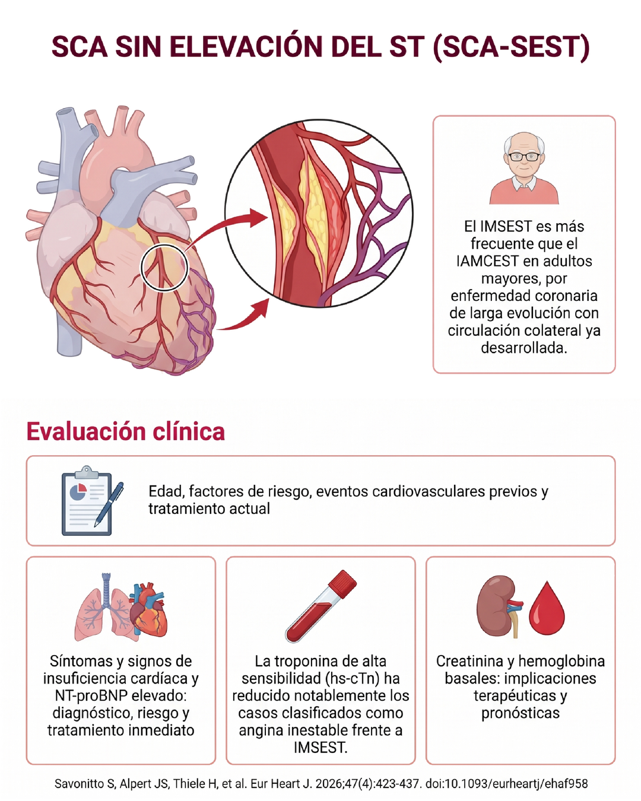 | 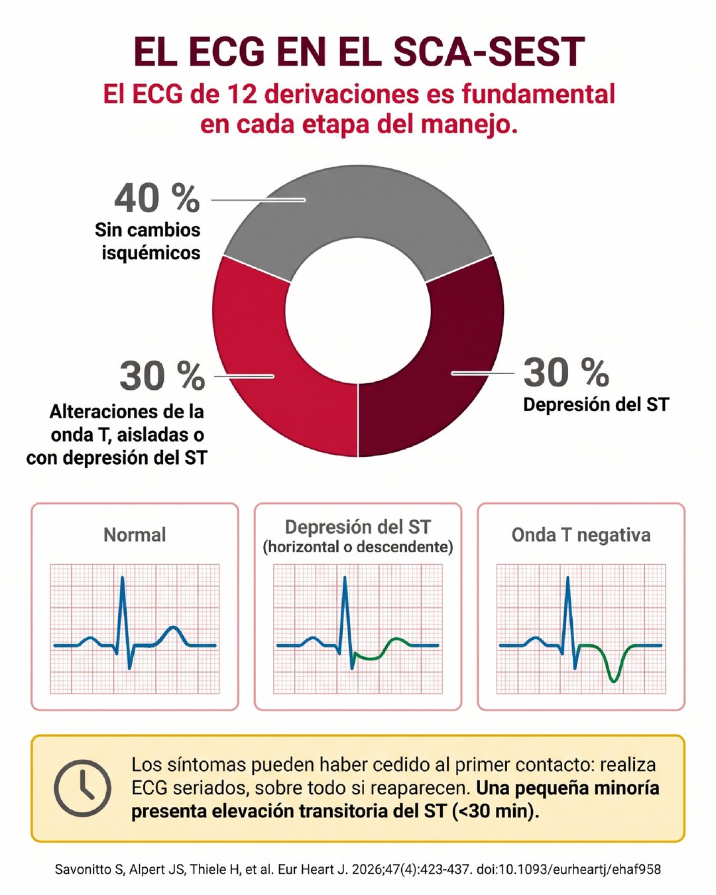 | 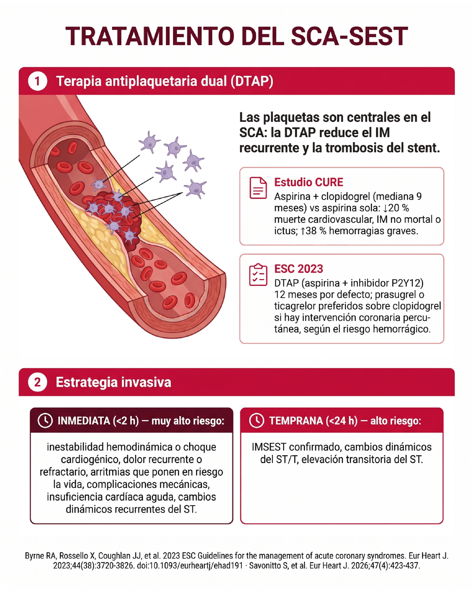 |

---

## 5. ACS according to the 2025 ACC/AHA Guideline

> This section is based on the **2025 ACC/AHA/ACEP/NAEMSP/SCAI Guideline** for the management of acute coronary syndromes. The figures are the original Spanish-language teaching slides.

### 5.1 Cause, spectrum and pathobiology

- ACS is caused by **disruption (rupture or erosion) of an unstable atherosclerotic plaque**, with partial or complete thrombosis and/or microembolization, which reduces myocardial blood flow and causes ischemia.
- It forms a **spectrum of severity**:
  - **Unstable angina:** transient ischemia without significant necrosis detectable by troponin.
  - **NSTEMI:** partially occluded artery, subendocardial ischemia and elevated biomarkers of myonecrosis.
  - **STEMI:** totally occluded vessel, transmural ischemia and infarction.
- Initial diagnosis and classification rely on **clinical history and symptoms, the ECG and cardiac troponin**.
- **Pathobiology of type 1 MI:** progressive lipid accumulation and inflammation → unstable plaque → rupture or erosion exposing plaque contents to the circulation → coagulation activation and thrombosis → compromised flow → ischemia → myonecrosis.
- **Dynamic pathophysiology:** patients may progress rapidly from unstable angina to NSTEMI or STEMI during presentation, evaluation and treatment. Less common causes of ischemia: coronary spasm, embolism and dissection.

| | |
|---|---|
| 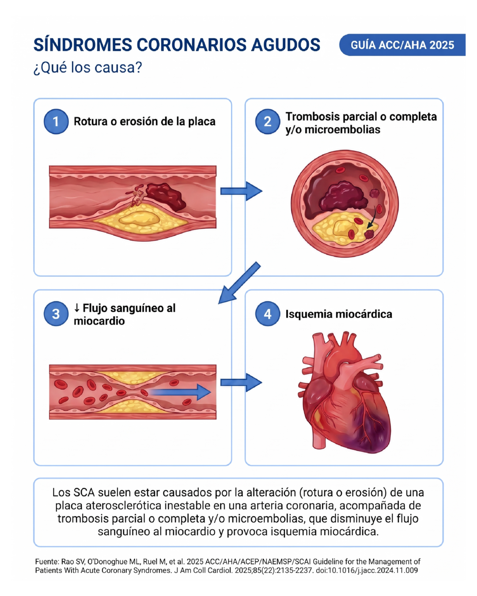 | 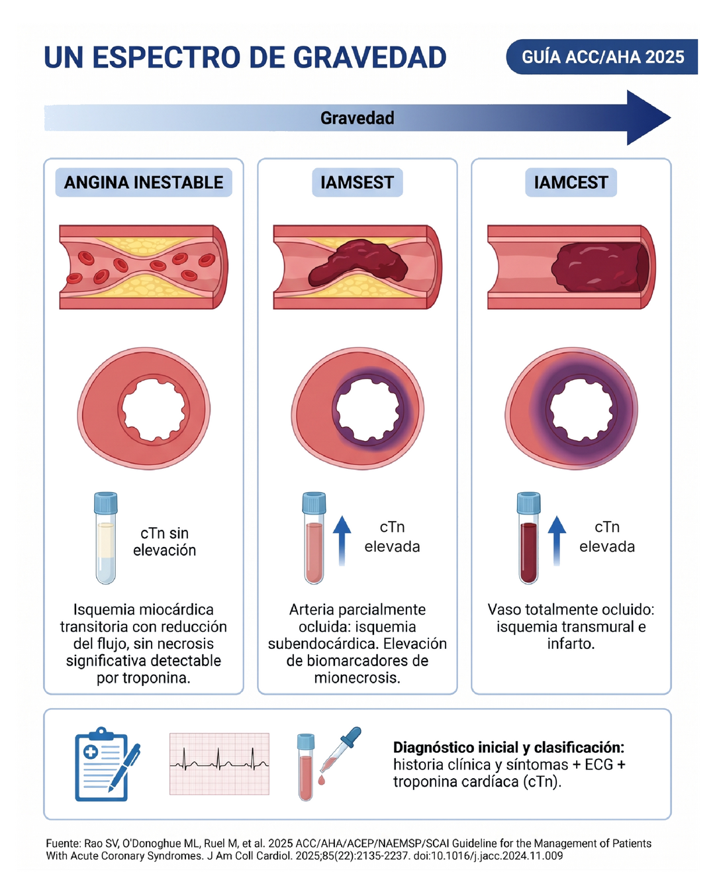 |
| 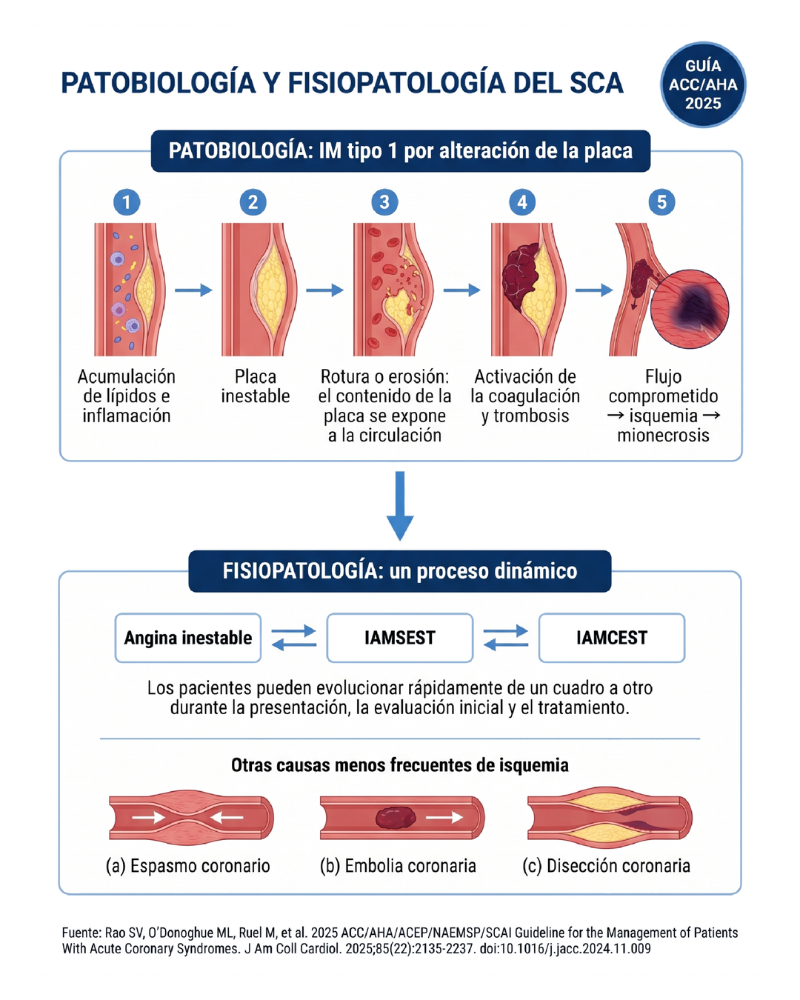 | 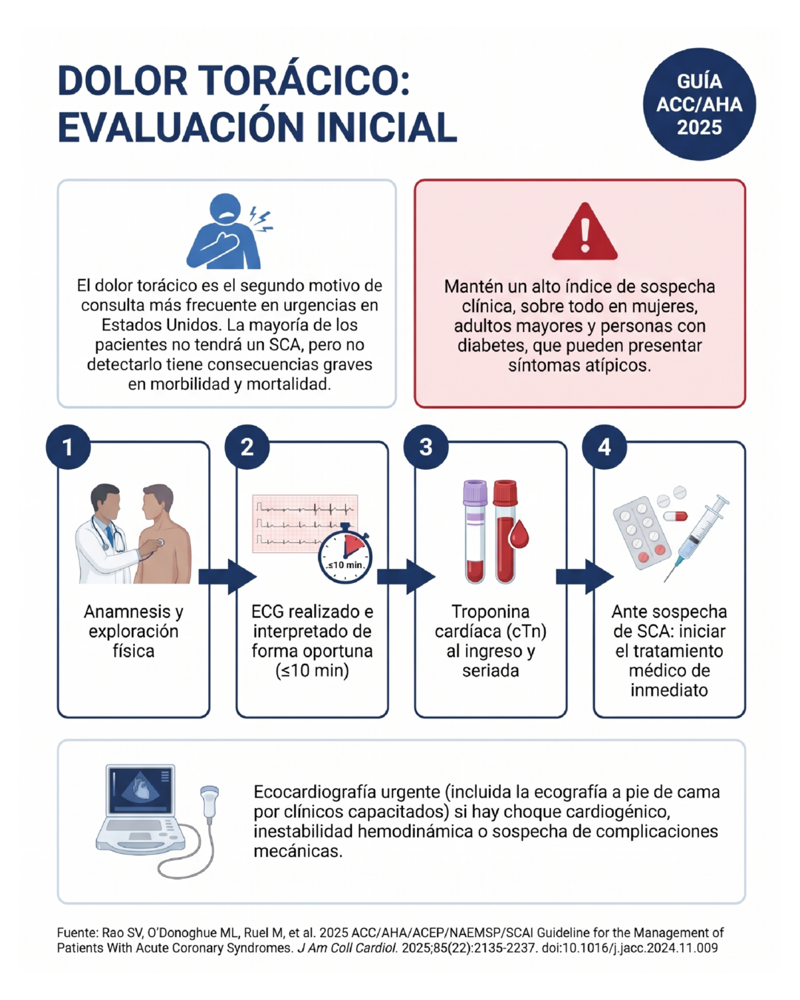 |

### 5.2 Initial evaluation of chest pain

- Chest pain is the **second most common reason** for emergency department visits in the United States. Most patients will not have ACS, but missing it has serious consequences for morbidity and mortality.
- With signs or symptoms of ACS: **history, physical examination, a timely ECG with interpretation, and cardiac troponin**.
- When ACS is suspected, **initial medical therapy should start immediately**.
- **Urgent echocardiography** (including point-of-care ultrasound by trained clinicians) for cardiogenic shock, hemodynamic instability or suspected mechanical complications.
- **STEMI:** rapid reperfusion is paramount; tests that delay catheterization or fibrinolysis should not be performed unless their results would immediately change management.
- The choice of additional testing depends on clinical history, ECG findings, biomarkers, patient preferences and ability to exercise.
- Evidence-based **clinical decision pathways** improve outcomes and reduce unnecessary testing by **21 % to 43 %** while maintaining a high **negative predictive value** for major adverse cardiovascular events (MACE).

> [!CAUTION]
> **Cardiogenic shock.** Present in **7 % to 10 %** of ACS, with high mortality. Early recognition is key to initial triage and risk stratification (see [section 9](#9-cardiogenic-shock)).

### 5.3 Initial medical therapy

> [!NOTE]
> **Oxygen.** Start supplemental oxygen only if saturation is **below 90 %**.

- **Aspirin** for all patients, and **dual antiplatelet therapy** with a P2Y12 inhibitor (clopidogrel).
- **Parenteral anticoagulation** for all patients with ACS, regardless of the initial strategy, to treat coronary atherothrombosis and reduce recurrent MACE.
- **High-intensity statin** immediately to reduce MACE risk.
- **Analgesia:**
  - If ischemic symptoms persist despite nitrates, pursue **rapid revascularization**; opioids should not be used only to mask symptoms.
  - Opioids may **delay absorption of oral P2Y12 inhibitors** (clopidogrel) and their pharmacodynamic effect in patients undergoing PCI; the clinical relevance of this finding is still debated.
  - **Avoid NSAIDs** for ischemic pain, even when ACS is only suspected: they are associated with higher MACE risk, with or without prior heart disease, and have no documented benefit in ACS.

---

## 6. ST-elevation MI (STEMI): the ICAT3 protocol

**Early reperfusion** in STEMI is a life-saving intervention and the single most important measure in its treatment: its goal is to restore flow in the infarct-related artery and ensure vessel patency.

### 6.1 ICAT3

| Letter | Step (Spanish) | Meaning |
|---|---|---|
| **I** | Identificación | Identification |
| **C** | Confirmación | Confirmation (12-lead ECG within 10 min) |
| **A** | Activación | Activation |
| **T** | Tratamiento | Treatment |
| **T** | Traslado | Transfer |
| **T** | Retorno a su vida | Return to normal life |

### 6.2 Algorithm

```
CHEST PAIN → FIRST-CONTACT CENTER → ECG <10 MIN
                                          │
             ┌────────────────────────────┴──────────────┐
      NO ST ELEVATION                              ST ELEVATION
                                       ┌──────────────┴──────────────┐
                               Transfer <60 min?             Transfer >60 min?
                                       │                             │
                                     pPCI                 Fibrinolysis protocol
                                                          + adjunctive therapy
                                                                     │
                                                  Contraindications to fibrinolysis?
                                                    YES → pPCI
                                                    NO  → Fibrinolysis → communication
                                                          + transfer → PHARMACOINVASIVE
                                                            STRATEGY
```

### 6.3 Time is muscle

| Time from symptom onset | Action |
|---|---|
| ≤90 min | Optimal window to salvage the most myocardium |
| ≤3 h | Best outcomes |
| ≤12 h | Reperfusion indicated (pPCI or fibrinolysis) |
| 12–24 h | Fibrinolysis **contraindicated**; angioplasty with smaller benefit, decide with cardiology |
| >24 h | Reperfusion offers no benefit over conservative treatment |

Main delays in Mexico: time to diagnosis (first contact → interpreted ECG), transfer time, and door-to-needle and door-to-balloon times.

### 6.4 Reperfusion strategies

- **Primary angioplasty (pPCI):** more effective (less recurrent ischemia, reinfarction, repeat revascularization and intracranial bleeding; better final flow). Transfer to the cath lab within <60 min.
- **Pharmacoinvasive strategy:** fibrinolysis followed by routine angioplasty within 3 to 24 h. As effective as pPCI and widely available; in Mexico, given transfer logistics and limited 24/7 cath labs, it is an attractive, accessible and effective strategy.
- If pPCI is delayed >60 min relative to fibrinolysis, outcomes are equivalent. Fibrinolysis may be better if the patient presents within <2 h and it is given within the first 30 min.

### 6.5 Adjunctive therapy (loading doses)

| Drug | Dose |
|---|---|
| Aspirin | 300 mg PO single dose |
| Clopidogrel | 300 mg PO single dose (75 mg if >75 years) |
| Atorvastatin | 80 mg PO single dose |
| Enoxaparin | 30 mg IV bolus (only if fibrinolysis will be given); 15 min later, 1 mg/kg SC every 12 h |

Enoxaparin adjustments per the manual: >75 years, 0.75 mg/kg SC every 12 h (maximum 75 mg); creatinine clearance <30 ml/min, 1 mg/kg SC every 24 h.

**IV access:** any access! Cephalic, basilic, median, dorsal: whichever is fastest.

### 6.6 Fibrinolytics: whichever is available!

| Drug | Regimen |
|---|---|
| Streptokinase | 1,500,000 IU over 30–60 min |
| Alteplase (>67 kg) | 20 mg bolus + 80 mg over 60 min |
| Accelerated alteplase (<67 kg) | 15 mg IV bolus + 0.75 mg/kg (max 50 mg) over 30 min + 0.5 mg/kg (max 35 mg) over 60 min |
| Tenecteplase (TNK) | Bolus over 5–10 s by weight: <60 kg 30 mg (6 ml) · 61–70 kg 35 mg (7 ml) · 71–80 kg 40 mg (8 ml) · 81–90 kg 45 mg (9 ml) · >91 kg 50 mg (10 ml) |
| Reteplase | Available as an alternative |

### 6.7 Indications for fibrinolysis

Chest pain suggestive of ischemia >20 min, associated with:

- persistent ST elevation >1 mm (0.1 mV) in 2 contiguous leads (except V2–V3: men >0.2 mV if >40 years and >0.25 mV if <40 years; women >0.15 mV);
- or presumably new left bundle branch block;
- or ST depression in V1–V3 with early transition and ST elevation in posterior leads (V7–V9) >0.5 mV.

Within 12 h of symptom onset and with no absolute contraindication.

### 6.8 Contraindications to fibrinolysis

| Absolute: do not lyse! | Relative: can they be treated? |
|---|---|
| History of intracranial hemorrhage | TIA in the last 6 months |
| Ischemic stroke in the previous 6 months | Oral anticoagulants |
| CNS neoplasm or arteriovenous malformation | Pregnancy or first postpartum week |
| Major trauma, surgery or closed head injury in the last 3 weeks | Refractory hypertension (SBP >180 and/or DBP >110 mmHg) |
| Gastrointestinal bleeding in the last 4 weeks | Advanced liver disease |
| Bleeding or hematological disorder (excluding menses) | Infective endocarditis |
| Aortic dissection (SBP difference between arms >15 mmHg) | Active peptic ulcer |
| Non-compressible vascular puncture in the last 24 h | Traumatic or prolonged resuscitation |

| | | |
|---|---|---|
| 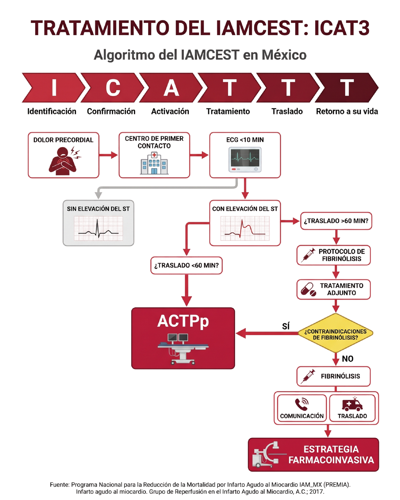 | 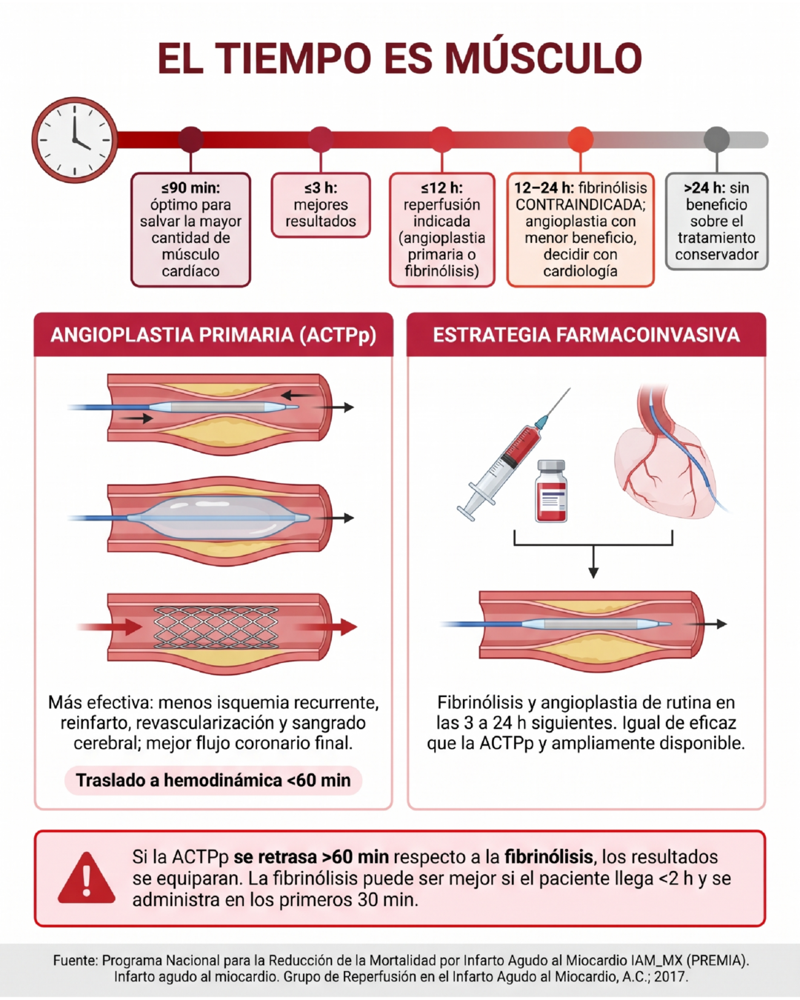 | 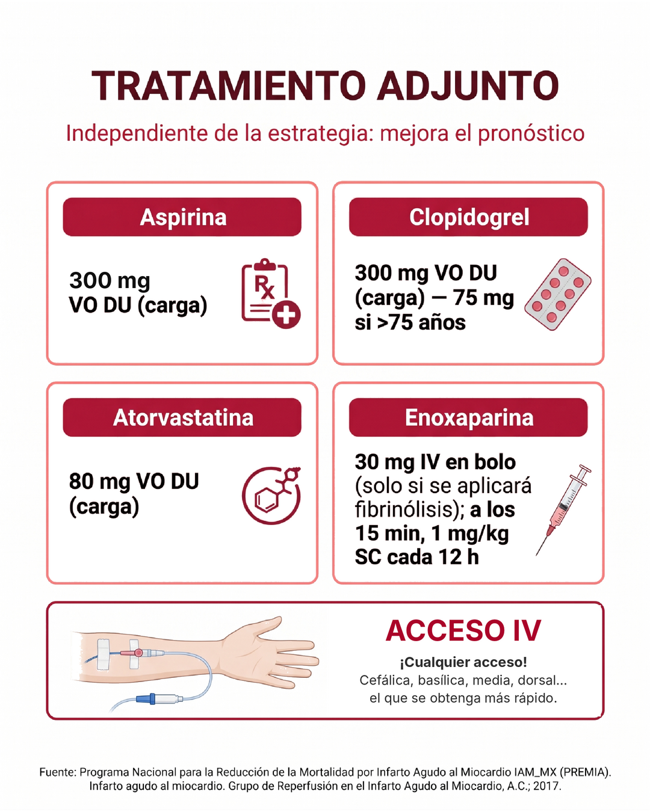 |
| 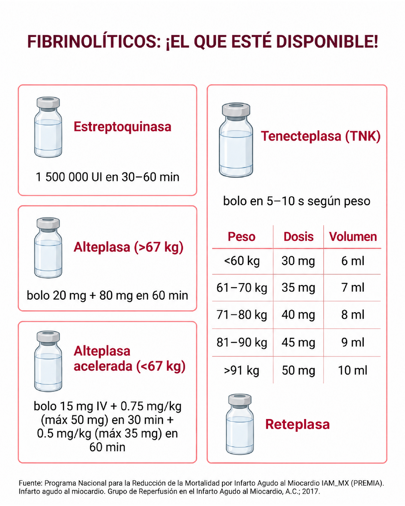 | 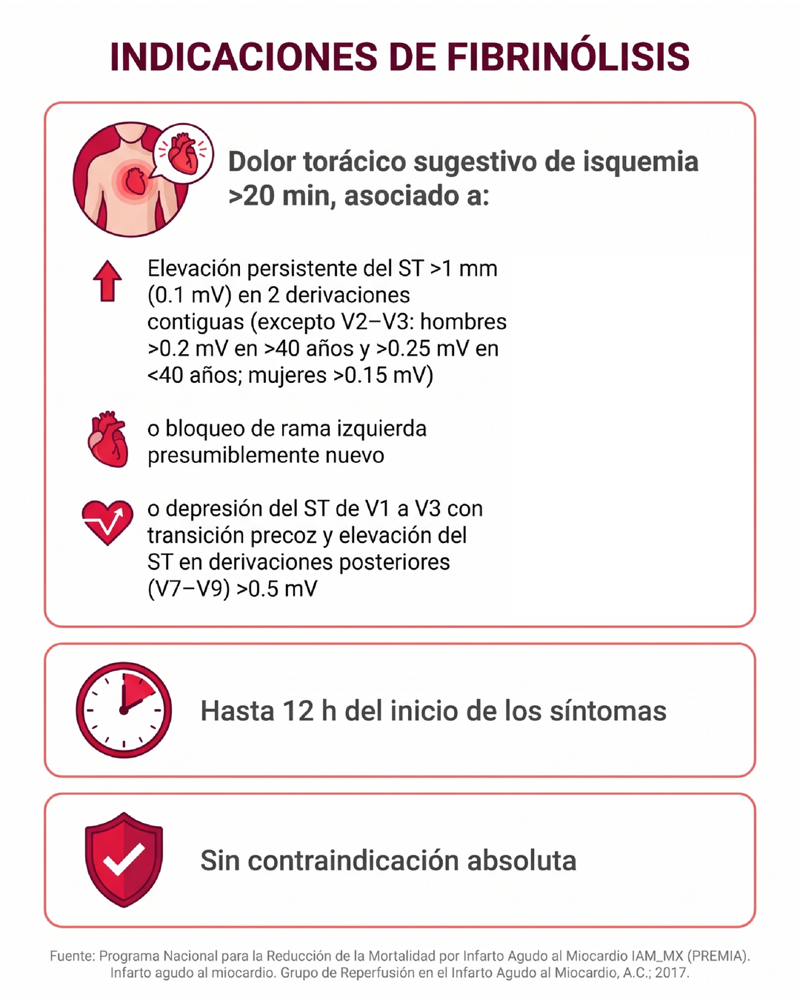 | 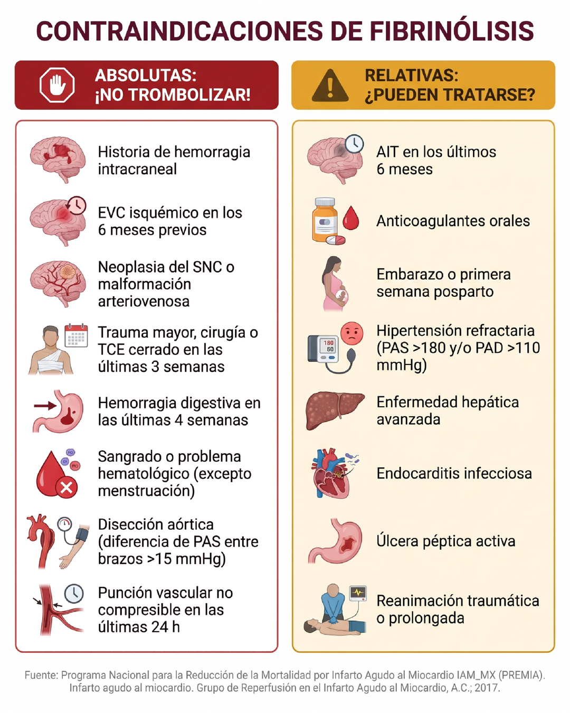 |

---

## 7. Chronic ischemic heart disease and ischemic cardiomyopathy

### 7.1 Terminology and the acute-to-chronic transition (iCARDIO Alliance 2026)

- **Chronic ischemic heart disease (CIHD):** the traditional term for stable manifestations of coronary atherosclerosis. The ESC introduced **chronic coronary syndromes** in 2019; ACC/AHA (2023) use **chronic coronary disease**.
- **When does the acute phase become chronic?** When the acute thrombotic process has resolved and the patient enters a period of relative pathophysiological stability.
- By convention, the chronic phase begins **12 months after an ACS**, when recurrent ischemic event rates plateau. Chronic does **not** mean low risk: atherosclerosis progresses and stable plaques may become vulnerable.

> [!IMPORTANT]
> **Atherosclerosis is a dynamic disease. Chronic does not mean risk-free.**

### 7.2 Ischemic cardiomyopathy

Reduced ability of the heart to pump blood due to myocardial damage caused by ischemia, almost always from coronary artery disease. Brief ischemia causes **reversible** loss of contractility; prolonged ischemia causes **irreversible** damage, fibrosis and remodeling, with ventricular dysfunction, arrhythmias and conduction abnormalities. It usually presents with **LVEF <40 %**.

**Risk factors.** Modifiable: diabetes, hypertension, smoking, dyslipidemia, obesity, sedentary lifestyle. Non-modifiable: age, sex, family history.

### 7.3 Clinical presentation

- Only **10–25 %** of patients undergoing testing have classic angina (substernal pressure with exertion or stress, relieved by rest or nitroglycerin).
- Most have nonspecific symptoms: chest discomfort, throat, arm or jaw discomfort, nausea, exertional dyspnea, diaphoresis or fatigue.
- **Women:** non-classic symptoms are more frequent (jaw pain, epigastric discomfort, nausea, fatigue), leading to under-recognition and delayed diagnosis. Scores such as SCORE2, PCE or PREVENT often underestimate their risk.
- **Older adults:** may present with syncope, delirium or breathlessness.
- With heart failure: dyspnea, orthopnea, exercise intolerance; crackles, S3 gallop, displaced apical impulse, jugular venous distension, hepatojugular reflux and edema.

### 7.4 Evaluation

| Test | Use |
|---|---|
| Resting ECG (≤10 min in acute pain) | Ongoing ischemia, prior MI (Q waves), conduction disorders, arrhythmias; V7–V9 and right-sided leads if posterior MI is suspected |
| High-sensitivity troponin | Rapid rule-out or rule-in of myocardial injury |
| CK-MB | Suspected reinfarction after recent MI, including post-procedural |
| Lipids, creatinine, microalbuminuria, glucose and HbA1c | Routine; look for reversible causes (anemia, hyperthyroidism). Myoglobin is no longer recommended |
| Lipoprotein(a) | Once in a lifetime; identifies risk of early or severe atherosclerosis |
| High-sensitivity CRP | Prognosis; may guide intensified lipid-lowering or anti-inflammatory therapy |
| BNP / NT-proBNP | Prognosis and heart failure |
| Chest X-ray | Cardiomegaly, congestion, Kerley B lines, effusion |
| Transthoracic echocardiography | LVEF, regional wall motion, valves, pericardium |
| Exercise or pharmacological stress testing | Ischemia and, in some modalities, viability |
| Coronary CT angiography | Diagnosis of CAD in low-to-intermediate risk |
| Coronary angiography | Coronary anatomy and percutaneous intervention |
| Cardiac MRI (late gadolinium enhancement) | Distinguishes ischemic from non-ischemic cardiomyopathy; no LGE = potential for recovery |
| Nuclear imaging (99mTc-sestamibi) | Viability: hibernating myocardium improves with revascularization |

### 7.5 Treatment

- **Lifestyle:** smoking cessation, exercise, diet.
- **Revascularization:** reperfuse viable ischemic myocardium; in ischemic cardiomyopathy, CABG reduced all-cause mortality by 7 % (absolute) over 10 years versus medical therapy.
- **Aspirin:** reduces cardiovascular morbidity and mortality (low dose, 75–100 mg daily).
- **High-intensity statin:** atorvastatin 40–80 mg or rosuvastatin 20–40 mg daily.
- **Beta-blockers:** reduce mortality in heart failure; do not start in acute decompensated HF.
- **ACE inhibitors / ARBs / ARNI:** reduce mortality in HF; ARNI (sacubitril/valsartan) superior to enalapril in PARADIGM-HF. Hydralazine + nitrate if ACEI and ARB are not tolerated.
- **Spironolactone:** reduces morbidity and mortality in HF with LVEF ≤35 % (NYHA III–IV).
- **Digoxin:** improves symptoms and hospitalizations, not mortality.
- **Ranolazine:** anti-ischemic and antiarrhythmic.
- **ICD:** prevention of sudden death with LVEF ≤35 % and NYHA II–III (≥40 days post-MI or 3 months after revascularization), or LVEF ≤30 % with NYHA I.
- **Cardiac resynchronization therapy:** LVEF ≤35 % with symptoms despite revascularization and optimal therapy.
- **Heart transplantation:** when disease progresses without response.

**Differential diagnosis:** Takotsubo cardiomyopathy, thyrotoxicosis, beriberi, tamponade, heavy-metal toxicity, late-stage hypertrophic cardiomyopathy, myocarditis, restrictive cardiomyopathy.

**Prognosis:** depends on myocardial viability; greater viability is associated with better outcomes after revascularization.

### 7.6 Figures (iCARDIO Alliance 2026)

| | |
|---|---|
| 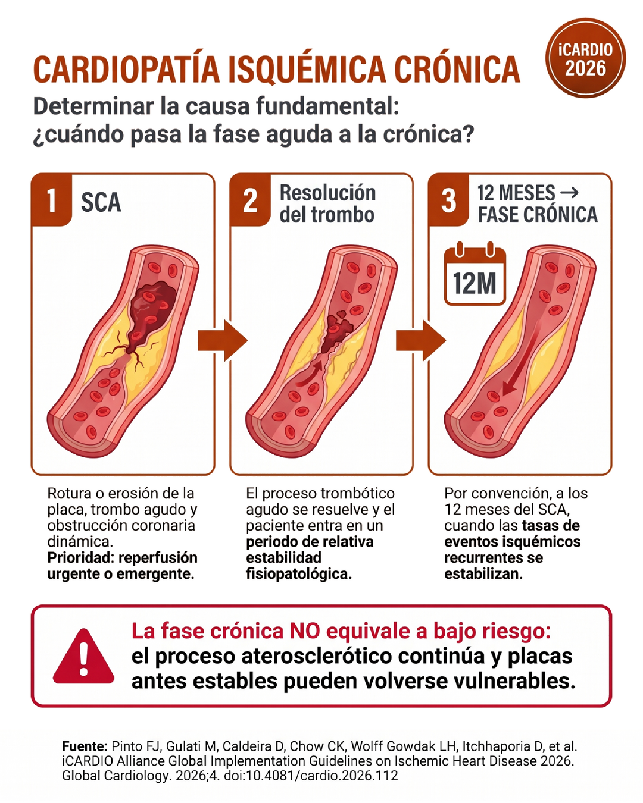 | 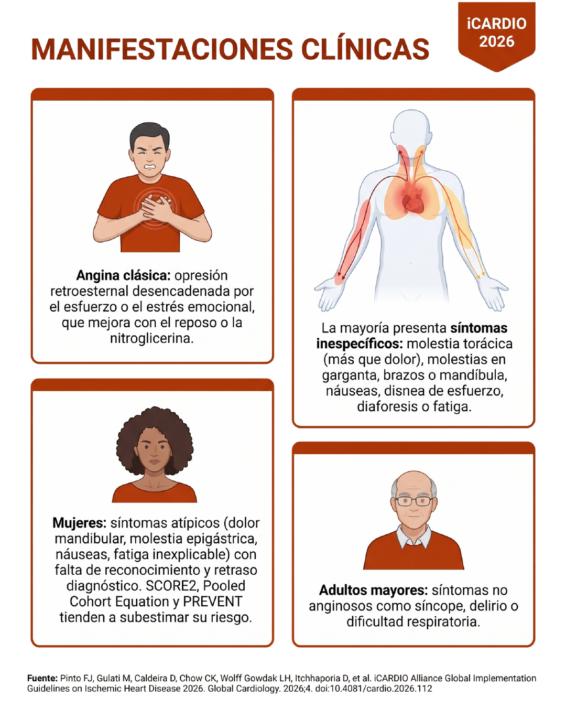 |
| 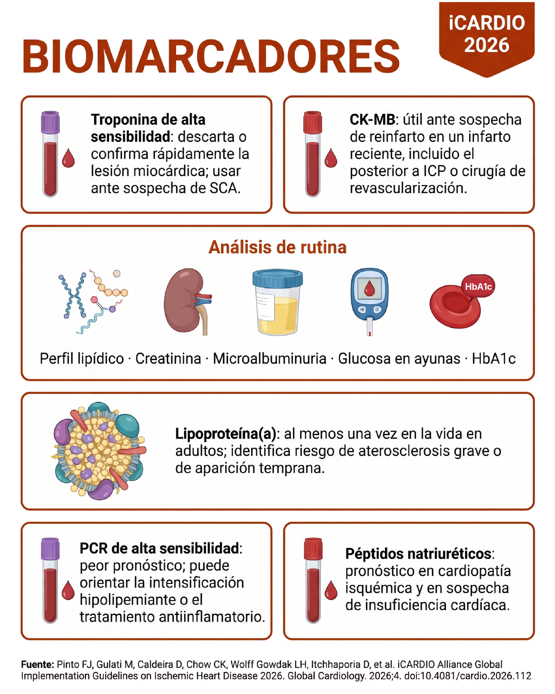 | 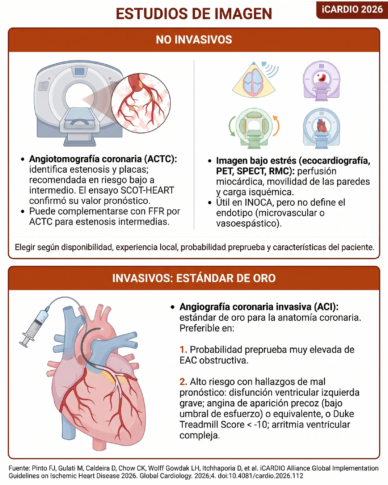 |

---

## 8. Summary: iCARDIO Alliance 2026

Global implementation guideline on ischemic heart disease:

1. **From acute to chronic:** ACS is characterized by plaque rupture or erosion, thrombosis and dynamic obstruction requiring urgent reperfusion; the chronic phase begins by convention at 12 months. Atherosclerosis is a dynamic disease: chronic does not mean risk-free.
2. **Chronic-phase focus:** appropriate identification, risk stratification, long-term secondary prevention and revascularization when indicated.
3. **Antithrombotic therapy:** a pillar of secondary prevention; its choice, intensity, duration and adaptation depend on the balance between ischemic and bleeding risk, comorbidities and time since the acute event.
4. **Symptoms:** classic angina is the minority (10–25 %); watch for atypical presentations in women and older adults.
5. **Biomarkers:** high-sensitivity troponin for ACS; CK-MB for recent reinfarction; routine lipids, creatinine, microalbuminuria, glucose and HbA1c; Lp(a) once in a lifetime; hs-CRP and natriuretic peptides for prognosis.
6. **ECG within 10 min** for all acute chest pain; serial ECGs and posterior or right-sided leads when the initial ECG is non-diagnostic.

---

## 9. Cardiogenic shock

> This section is based on Gopar-Nieto R, et al. Arch Cardiol Mex. 2026 (reference 12).

### 9.1 Definition

Cardiogenic shock (CS) is the most severe form of hypoperfusion caused by cardiac dysfunction, with **reduced cardiac output** and **elevated intracardiac filling pressures**. It is defined as ineffective cardiac output due to cardiac dysfunction that produces clinical and biochemical manifestations of hypoperfusion.

| Clinical | Biochemical |
|---|---|
| Diaphoresis, cold extremities, oliguria (<30 mL/h), dizziness, mental confusion, diminished distal pulses | Metabolic acidosis, ↑ creatinine, lactate >2.0 mmol/L |

> [!CAUTION]
> **SBP <90 mmHg for >30 min** or the need for vasoactive amines is also a criterion, but it may be absent in early stages of CS.

### 9.2 Epidemiology

- **80 %** is due to acute coronary syndromes and **20 %** to heart failure.
- **4–12 %** of patients with ACS develop CS: 30–40 % is detected on admission and 60–70 % during hospitalization.
- In Mexico, at a referral center, CS accounted for **3.7 %** of all admissions over 13 years.
- In-hospital mortality: **~40 %** in developed countries and **up to 70 %** in developing countries.
- Among survivors, first-year mortality reaches **50–60 %**; 70–80 % of it occurs in the first 30–60 days.
- Data in Mexico are insufficient: better statistical registries and interdisciplinary shock teams in hospitals are needed.

### 9.3 Pathophysiology

Microvascular dysfunction and the systemic inflammatory response syndrome (SIRS) reduce cardiac output; hypoperfusion and volume overload feed back into inflammation and, if the cycle is not stopped, **multiorgan failure** follows.

- **In ACS:** loss of myocardium → ↓ LV contractility → compensatory vasoconstriction → ↑ central venous pressure and veno-arterial uncoupling → congestion and inflammation that perpetuate the cycle.
- **In HF:** repeated cycles of inflammation and volume mismatch → frequent decompensations → hypoperfusion and congestion.

> [!IMPORTANT]
> The microcirculation precedes and determines the macrocirculation: up to **45 %** of patients who die of CS have a cardiac index **≥2.2 L/min/m²**. Brain, kidney, liver, gastrointestinal and respiratory function are affected.

### 9.4 Approach and risk stratification

Act immediately in at-risk patients: recent MI with extensive electrical involvement or known heart failure.

| Phase | Features |
|---|---|
| Pre-shock | Hypoperfusion (cold extremities, oliguria, ↑ lactate, acidosis) even with SBP >90 mmHg; compensatory ↑ peripheral vascular resistance and tachycardia |
| Shock | Hypoperfusion + hypotension, ↑ filling pressures, systemic congestion |
| Refractory shock | Hypoperfusion unresponsive to established strategies |

**SCAI classification (2019):** A (*At risk*); B (*Beginning*) pre-shock; C (*Classic*) hypoperfusion + hypotension; D (*Deteriorating*) requires escalation of therapy; E (*Extremis*) circulatory collapse.

**Triaxial assessment (ACC expert consensus):** 1) SCAI stage; 2) clinical phenotype (pure cardiogenic, mixed or distributive); 3) risk modifiers (age, comorbidity, elevated lactate, multiorgan dysfunction).

### 9.5 Treatment

- **Paradigm:** unload the LV and provide hemodynamic support. None of these therapies has been shown to reduce short-term mortality.
- **CS due to ACS:** reperfusion of the infarct-related artery plus support to allow ventricular recovery.
- **Three phases:** 1) **rescue**: maintain BP and stabilize; 2) **optimization**: adjust drugs according to tissue perfusion and consider ventricular assist devices and ventilation; 3) **weaning**: reduce drugs and support.
- **Vasoactive drugs:** used in 90 % of patients; they maintain BP and inotropy but increase myocardial O₂ consumption and arrhythmia risk.

| Scenario | Hypotension | Normotension |
|---|---|---|
| ACS | Norepinephrine | Dobutamine, milrinone or levosimendan |
| Decompensated HF | Norepinephrine | Dobutamine, milrinone, levosimendan or epinephrine + nitroprusside |
| RV failure | Norepinephrine | Milrinone or levosimendan |

### 9.6 Figures

| | |
|---|---|
| 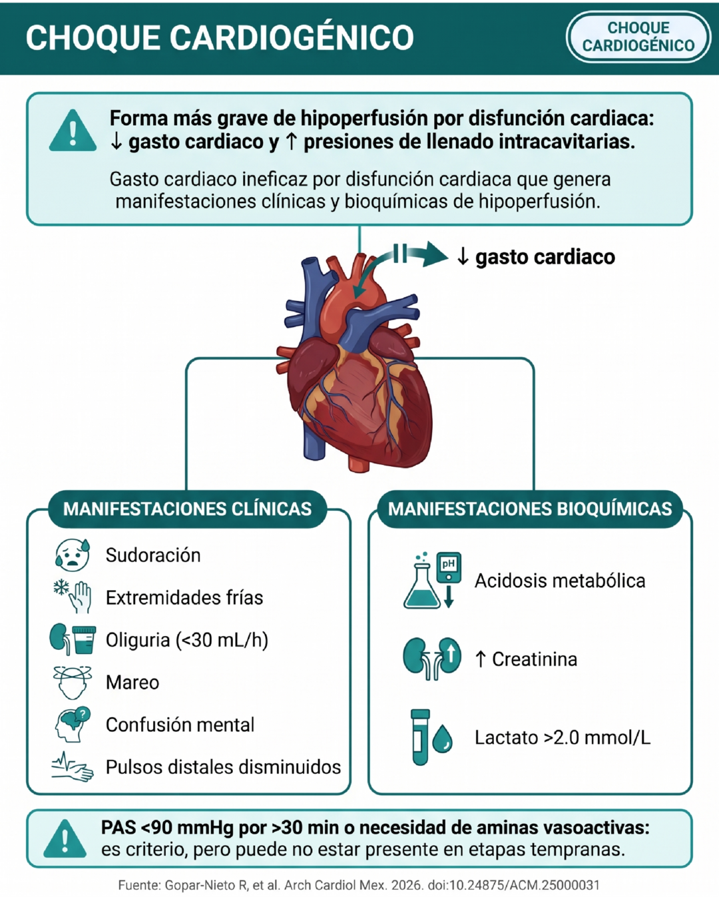 | 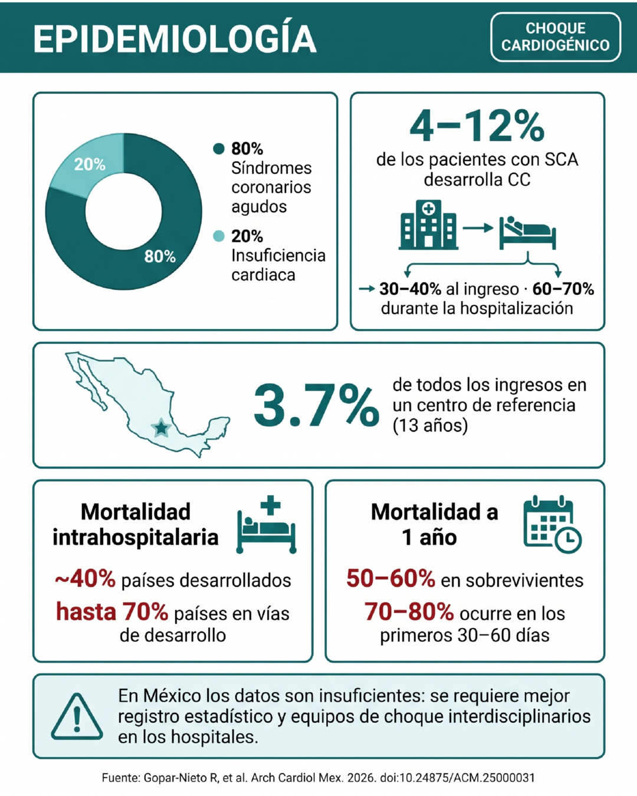 |
| 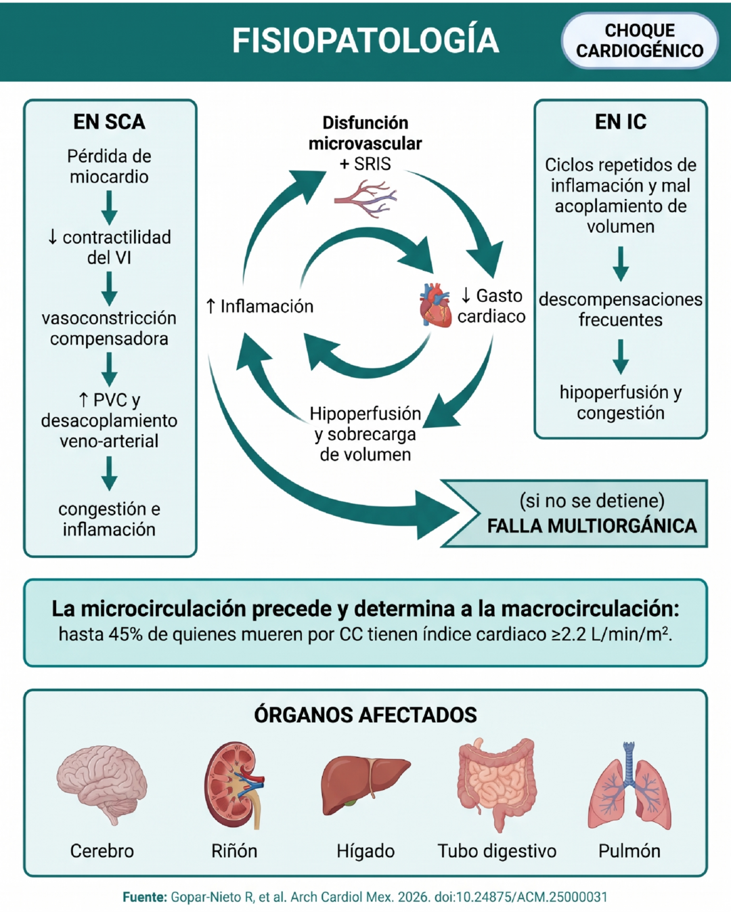 | 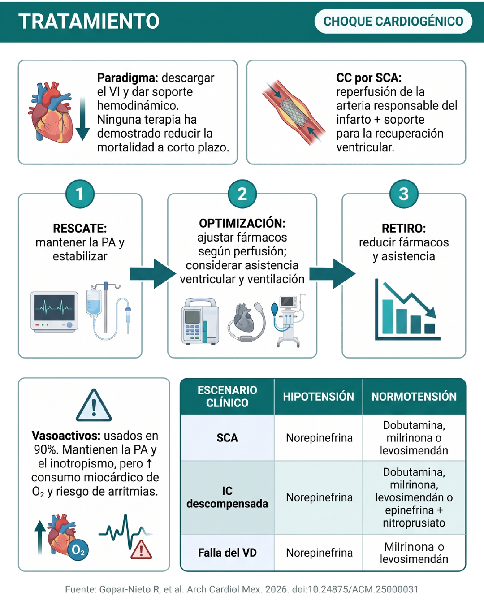 |

---

## 10. References

1. Instituto Nacional de Estadística y Geografía (INEGI). Estadísticas de Defunciones Registradas (EDR), January–March 2026 (preliminary). Release 36/26; 18 September 2026. https://www.inegi.org.mx/contenidos/saladeprensa/boletines/2026/edr/EDR2026-1erT_RR.pdf
2. OECD. Health at a Glance 2025: country note, Mexico. https://www.oecd.org/content/dam/oecd/es/publications/reports/2025/11/health-at-a-glance-2025-country-notes_2f94481e/mexico_0c55bf71/42bdb5b4-es.pdf
3. Moguel-Ancheita R, Arce-Piña L, Lozoya-Morales JJ, Ramos-Cházaro E, Cuevas-Cueto D, Lozoya-del-Rosal JJ, et al. Consenso Mexicano sobre la Cardiopatía Isquémica Crónica. Diagnóstico, clasificación y estratificación no invasivos. COMECITE. Cardiovasc Metab Sci. 2021;32(s4):s317-s346. https://dx.doi.org/10.35366/101973
4. Mills NL, Newby LK, Zaman S, et al. Fifth Universal Definition of Myocardial Infarction (2026). Circulation. 2026. https://doi.org/10.1161/CIR.0000000000001477
5. Byrne RA, Rossello X, Coughlan JJ, et al. 2023 ESC Guidelines for the management of acute coronary syndromes. Eur Heart J. 2023;44(38):3720-3826. https://doi.org/10.1093/eurheartj/ehad191
6. Jerjes-Sánchez C, Martínez-Sánchez C, Borrayo-Sánchez G, Carrillo-Calvillo J, Juárez-Herrera U, Quintanilla-Gutiérrez J. Tercer Registro Nacional de Síndromes Coronarios Agudos (RENASICA III). Arch Cardiol Mex. 2015;85(3):207-14. https://doi.org/10.1016/j.acmx.2015.04.001
7. Savonitto S, Alpert JS, Thiele H, et al. Non-ST-segment elevation acute coronary syndrome: understanding the full spectrum to guide management. Eur Heart J. 2026;47(4):423-437. https://doi.org/10.1093/eurheartj/ehaf958
8. Programa Nacional para la Reducción de la Mortalidad por Infarto Agudo al Miocardio IAM_MX (PREMIA). Infarto agudo al miocardio. Grupo de Reperfusión en el Infarto Agudo al Miocardio, A.C.; 2017. https://calidad.salud.gob.mx/site/iam/docs/iam_01.pdf
9. Bhandari B, Quintanilla Rodriguez BS, Saad Eddin A, et al. Ischemic Cardiomyopathy. [Updated 31 Jul 2023]. In: StatPearls. Treasure Island (FL): StatPearls Publishing; 2023. https://www.ncbi.nlm.nih.gov/books/NBK537301/
10. Pinto FJ, Gulati M, Caldeira D, Chow CK, Wolff Gowdak LH, Itchhaporia D, et al. iCARDIO Alliance Global Implementation Guidelines on Ischemic Heart Disease 2026. Global Cardiology. 2026;4. https://doi.org/10.4081/cardio.2026.112
11. Rao SV, O'Donoghue ML, Ruel M, et al. 2025 ACC/AHA/ACEP/NAEMSP/SCAI Guideline for the Management of Patients With Acute Coronary Syndromes: A Report of the American College of Cardiology/American Heart Association Joint Committee on Clinical Practice Guidelines. J Am Coll Cardiol. 2025;85(22):2135-2237. https://doi.org/10.1016/j.jacc.2024.11.009
12. Gopar-Nieto R, García-Villarejo M, Arias-Escarpulli R, et al. How to approach and treat cardiogenic shock? Update and perspectives on pharmacological and mechanical treatment. Arch Cardiol Mex. 2026. https://doi.org/10.24875/ACM.25000031
